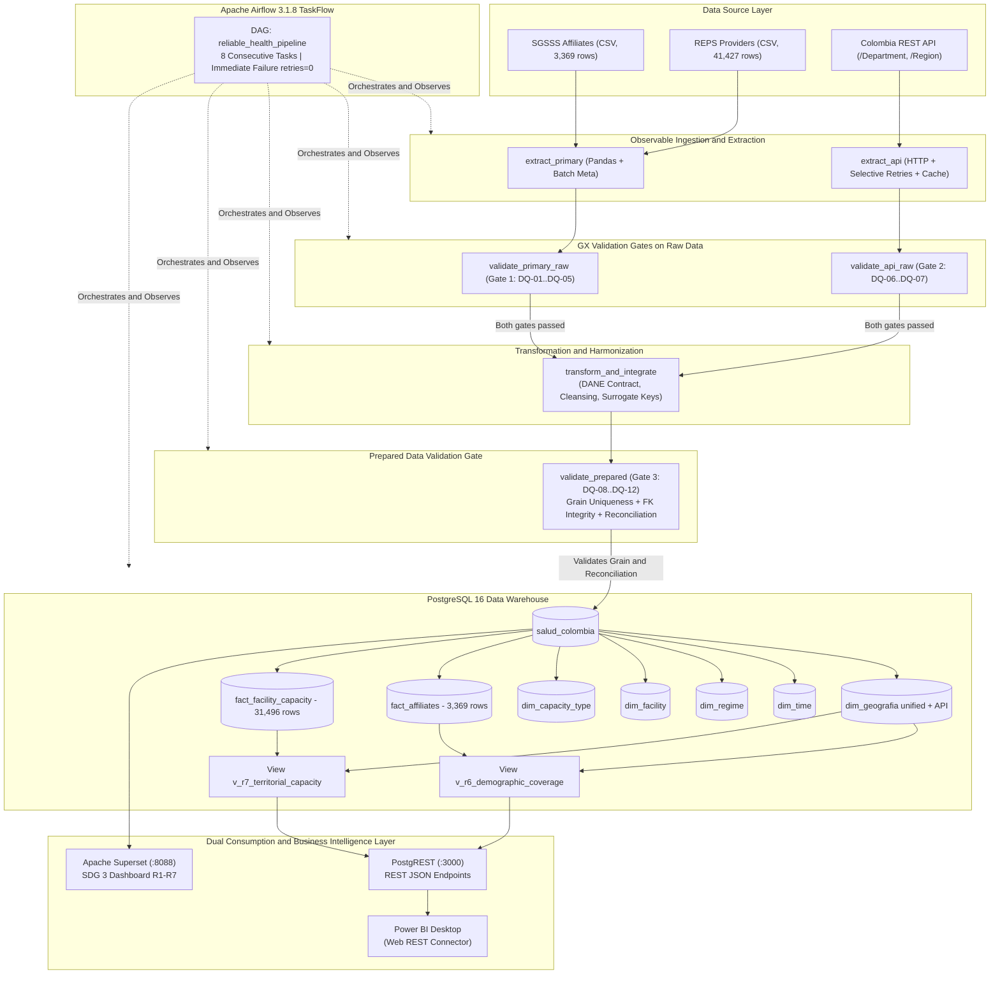
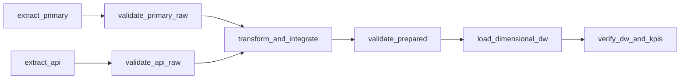

# Pipeline (Colombia Health × Colombia API — SDG 3)
A production-style batch pipeline with reliability as the first priority: SGSSS Affiliates CSV (3,369 rows) + REPS Providers CSV (41,427 rows) + Colombia REST API (33 departments, 6 regions) → three Great Expectations validation gates (primary raw, API raw and prepared data) → harmonization and integration on the official DANE key → reliable dimensional Data Warehouse (PostgreSQL 16) → dual analytics layer: PostgREST (for Power BI Desktop) and Apache Superset (interactive BI for KPIs R1–R7), orchestrated by Apache Airflow 3.1.8 with the TaskFlow API (8 tasks).

> **Reliability does not mean that nothing fails. Reliability means that failures are anticipated, controlled and observable — and that a re-run never corrupts the analytics target.**

---

## Table of Contents
1. [Analytical Problem and Objectives](#1-analytical-problem-and-objectives)
2. [Granularity and Grain Declaration](#2-granularity-and-grain-declaration)
3. [Analytical Requirements and Expected Outcomes (R1 to R7)](#3-analytical-requirements-and-expected-outcomes-r1-to-r7)
4. [Data Sources and Value Added by the Colombia API](#4-data-sources-and-value-added-by-the-colombia-api)
5. [Data System Architecture](#5-data-system-architecture)
6. [Data Profiling and Quantitative Findings](#6-data-profiling-and-quantitative-findings)
7. [Data Quality Rule Catalog (DQ-01 to DQ-12)](#7-data-quality-rule-catalog-dq-01-to-dq-12)
8. [Validation Design with Great Expectations](#8-validation-design-with-great-expectations)
9. [Transformation Strategy and DANE Integration Contract](#9-transformation-strategy-and-dane-integration-contract)
10. [Conformed Dimensional Model (Data Warehouse)](#10-conformed-dimensional-model-data-warehouse)
    - [10.1 Design Methodology](#101-design-methodology)
    - [10.2 Entity-Relationship Diagram of the Star Schema](#102-entity-relationship-diagram-of-the-star-schema)
    - [10.3 Table and View Catalog](#103-table-and-view-catalog)
    - [10.4 Database Separation (Infrastructure Adjustment)](#104-database-separation-infrastructure-adjustment)
    - [10.5 ETL Traceability (`audit` Schema)](#105-etl-traceability-audit-schema)
    - [10.6 Model Evolution Rules (How to Grow Without Breaking)](#106-model-evolution-rules-how-to-grow-without-breaking)
11. [Orchestration and Retry Policies with Apache Airflow 3.1.8](#11-orchestration-and-retry-policies-with-apache-airflow-318)
12. [Mandatory Reliability Tests (Tests A, B and C)](#12-mandatory-reliability-tests-tests-a-b-and-c)
13. [Consumption and Business Intelligence Layer (PostgREST, Power BI, Superset)](#13-consumption-and-business-intelligence-layer-postgrest-power-bi-superset)
14. [End-to-End Traceability Matrix](#14-end-to-end-traceability-matrix)
15. [How to Use the Repository](#15-how-to-use-the-repository)
    - [15.1 run.sh / run.bat (Single Entry Point)](#151-runsh--runbat-single-entry-point)
    - [15.2 Services, Ports and Clients (Host / Windows 11 VM)](#152-services-ports-and-clients-host--windows-11-vm)
    - [15.3 Connecting with DBeaver (Exploring salud_colombia)](#153-connecting-with-dbeaver-exploring-salud_colombia)
    - [15.4 Connecting Power BI Desktop (Via PostgREST)](#154-connecting-power-bi-desktop-via-postgrest)
    - [15.5 Manual Execution (Without run.sh)](#155-manual-execution-without-runsh)
    - [15.6 Local Pipeline on the Host (Without Airflow)](#156-local-pipeline-on-the-host-without-airflow)
    - [15.7 Repository Structure](#157-repository-structure)
    - [15.8 Assumptions and Limitations](#158-assumptions-and-limitations)
16. [Key Business Findings (R1–R7)](#16-key-business-findings-r1r7)

---

## 1. Analytical Problem and Objectives

### 1.1 Context: Territorial Disparities in the SGSSS
Colombia's General Social Security Health System (SGSSS) formally reports nominal affiliation exceeding 51 million citizens (~99% of the census population). However, there is a deep structural disparity between formal affiliation and effective access to the physical care infrastructure:
- Andean departments concentrate high volumes of beds and surgery rooms in the contributory regime and among private providers.
- Peripheral departments (Amazon, Orinoquía and Pacific regions) depend almost exclusively on the subsidized regime and on a public network with fewer than 1 hospital bed per 1,000 inhabitants, far below the WHO international standard (>2.5 beds/1,000 pop).

### 1.2 System Objective
Build an **observable, modular batch ETL pipeline with automated reliability tests**, capable of:
1. Extracting and validating primary affiliation and provider microdata together with the external Colombia demographic API.
2. Enforcing quality gates through **Great Expectations (GX)** that halt execution on critical violations without contaminating the warehouse.
3. Loading a **dimensional Data Warehouse in PostgreSQL 16** with surrogate keys, strict referential integrity and full metric reconciliation.
4. Exposing dimensional views for **Apache Superset** and **Power BI Desktop** (via **PostgREST** over HTTP/JSON) to monitor the 7 territorial coverage requirements (SDG 3 / Target 3.8).

---

## 2. Granularity and Grain Declaration

To prevent aggregation anomalies ("double counting") and to ensure that every fact has a unique dimensional identity, the following grain declaration is formalised:

| Fact Table | Formal Grain Declaration | Grain Key | Measures Stored | Additive Behaviour | Loaded Records |
| :--- | :--- | :--- | :--- | :--- | :--- |
| **`fact_affiliates`** | One record per **Municipality (`sk_geografia`)**, per **Quarter (`sk_time`)**, for a specific **Affiliation Regime (`sk_regime`)**. | `(sk_time, sk_geografia, sk_regime)` | `numero_afiliados` (INTEGER) | Fully additive across time, geography and regime. | **3,369** rows (51,182,238 people) |
| **`fact_facility_capacity`** | One record per **Provider Site (`sk_facility`)**, per **Snapshot Date (`sk_time`)**, for a specific **Capacity Type (`sk_capacity_type`)** at its respective **Location (`sk_geografia`)**. | `(sk_time, sk_facility, sk_capacity_type, sk_geografia)` | `capacity_amount` (INTEGER) | Semi-additive over time (inventory snapshot); additive across geography, type and provider. | **31,496** rows (Beds, Rooms, Consulting Rooms) |

---

## 3. Analytical Requirements and Expected Outcomes (R1 to R7)

The system fully supports the base requirements (R1–R5) and the external demographic integration requirements (R6 and R7):

| ID | Requirement / Business Question | Sources Involved | Join Key | Analytical Grain | Metric / KPI Computed | Expected BI Output |
| :--- | :--- | :--- | :--- | :--- | :--- | :--- |
| **R1** | **Distribution by Regime:** What is the percentage share of affiliates in each regime? | Affiliates CSV | Regime ID | National by Regime | `total_afiliados` and `% participacion = (Affiliates / Total) * 100` | KPI + doughnut / bar chart of regimes |
| **R2** | **Departmental Concentration:** Which are the 10 departments with the highest and lowest volume of affiliates? | Affiliates CSV | `codigo_dane_depto` | Departmental | `total_afiliados` sorted ascending and descending | Horizontal bar chart (Top 10 / Bottom 10) |
| **R3** | **REPS Capacity Matrix:** How is the infrastructure distributed by legal nature and care level? | Providers CSV (REPS) | `sk_facility` | Nature × Level | IPS count and sum of `capacity_amount` per group | Matrix table and stacked bar chart |
| **R4** | **Capacity per Affiliate:** What is the ratio of available installed capacity per affiliate in each department? | REPS CSV + Affiliates CSV | `codigo_dane_depto` | Departmental | `capacity_per_affiliate = total_capacity / total_affiliates` | Territorial map / scatter plot |
| **R5** | **Regional Equity:** How does Subsidized vs Contributory regime penetration vary across the 6 macro-regions? | Affiliates CSV | `region` | Regional × Regime | `% subsidized` vs `% contributory` within each region | 100% stacked bar chart per region |
| **R6** | **Demographic Coverage and Health Gap:** What is the real coverage rate against the official census population? | Affiliates CSV + Colombia API (`/Department`) | `codigo_dane_depto` | Departmental | `cobertura_pct = (Affiliates / Poblacion_API) * 100` and `brecha = Poblacion - Affiliates` | National KPI + Gauge / Alert indicator |
| **R7** | **Hospital Density and Territorial Alert:** Do departments meet the WHO standard (>2.5 beds/1k pop) and what is their territorial density? | REPS CSV + Colombia API (`/Department`) | `codigo_dane_depto` | Departmental | `camas_por_1000_hab = (Beds / Poblacion) * 1000` and `densidad_km2 = Capacity / Surface` | Scatter plot (Beds/1k pop vs Surface km²) |

---

## 4. Data Sources and Value Added by the Colombia API

1. **Primary Source 1 — SGSSS Affiliates (`affiliates_by_department_municipality_regime_...csv`):**
   - Granularity: Municipality × Regime × Quarter (Snapshot April 2022 / Q2).
   - Volume: 3,369 raw rows. Zero nulls in the master columns.
   - Regimes: `S` (Subsidized), `C` (Contributory), `E` (Special), `I` (Exception/Individual).
2. **Primary Source 2 — REPS Providers and Infrastructure (`healthcare_facilities_by_level_capacity_...csv`):**
   - Granularity: Provider site × Service × Installed capacity (Snapshot November 2022).
   - Volume: 41,427 raw rows. 9,320 unique providers, 10,921 enabled sites.
   - Groups: Consulting Rooms (16,053), Rooms (7,597), Beds (6,738), Ambulances (5,340), Stretchers (4,409).
3. **Secondary Source — Colombia REST API (`https://api-colombia.com/api/v1`):**
   - Endpoints consumed: `/Department` (33 records) and `/Region` (6 records).
   - Attributes acquired: `population`, `surface` (km²), `cityCapital`, `municipalities`, `phonePrefix`, `regionId`.
   - **Value Added:** Turns internal administrative counts into real per-capita demographic indicators (`camas_por_1000_hab`) and territorial densities (`capacidad_por_1000_km2`). It features an exponential backoff retry mechanism and an offline local cache fallback (`data/raw/api_departments_raw.json`).

---

## 5. Data System Architecture



---

## 6. Data Profiling and Quantitative Findings

Automated profiling runs through `src/profile_data.py` and produces traceable evidence in `docs/evidence/profiling/data_profiling_evidence.json`:

1. **SGSSS Affiliates:**
   - 3,369 complete rows. No nulls in `department`, `municipality`, `regime_id` or `num_persons`.
   - Regime distribution: Subsidized (1,124), Contributory (1,122), Special (1,115), Exception (8).
   - National total of people: **51,182,238 affiliates**.
2. **REPS Providers and Infrastructure:**
   - 41,427 raw rows reduced to 10,921 unique provider sites after de-duplicating multi-service records.
   - Legal nature: 25,067 private (60.5%), 16,174 public (39.0%), 186 mixed (0.5%).
   - Care level: Level 1 (12,588), Level 2 (2,424), Level 3 (1,149), 25,266 without level (basic ambulatory care).
3. **Integration with the Colombia API:**
   - Raw match without normalization: **93.94%** (31 of 33 departments matched directly).
   - Detected naming inconsistencies: `BOGOTA` (API) vs `BOGOTA D.C.` (DANE) and `SAN ANDRES Y PROVIDENCIA` (API) vs `SAN ANDRES` (DANE).
   - Post-harmonization match with the Integration Contract: **100.0%** (33/33 departments matched successfully with population and surface).

---

## 7. Data Quality Rule Catalog (DQ-01 to DQ-12)

Each rule has a typed severity, a Great Expectations mathematical expectation and a deterministic pipeline action:

| ID | Layer / Dataset | Dimension | Evaluated Attribute | Quality Rule | Great Expectations Expectation | Threshold | Severity | Pipeline Action | Reqs |
| :--- | :--- | :--- | :--- | :--- | :--- | :--- | :--- | :--- | :--- |
| **DQ-01** | Raw Affiliates | Completeness | Master columns | The 8 columns of the affiliates schema must be present and non-null | `expect_table_columns_to_match_set` | 100% | **CRITICAL** | Blocks transformation | R1, R2, R5, R6 |
| **DQ-02** | Raw Affiliates | Validity | `regime_id` | Regime code must belong to the allowed set `{'S', 'C', 'E', 'I'}` | `expect_column_values_to_be_in_set` | 100% | **CRITICAL** | Blocks transformation | R1, R5 |
| **DQ-03** | Raw Affiliates | Validity | `num_persons` | Number of affiliates must be a positive integer or zero (not negative) | `expect_column_values_to_be_between` | 100% | **CRITICAL** | Blocks transformation | R1, R2, R6 |
| **DQ-04** | Raw REPS | Completeness | `provider_code, capacity` | Provider identifier and installed capacity are mandatory | `expect_column_values_to_not_be_null` | >= 99.5% | **CRITICAL** | Blocks transformation | R3, R4, R7 |
| **DQ-05** | Raw REPS | Validity | `installed_capacity` | The installed capacity measure must be non-negative (`>= 0`) | `expect_column_values_to_be_between` | 100% | **CRITICAL** | Blocks transformation | R3, R4, R7 |
| **DQ-06** | Raw API | Completeness | `department_name, api_id` | Department names and primary keys must be non-null in the REST payload | `expect_column_values_to_not_be_null` | 100% | **CRITICAL** | Blocks API branch | R6, R7 |
| **DQ-07** | Raw API | Validity | `population, surface` | Census population and territorial surface must be strictly positive (`> 0`) | `expect_column_values_to_be_between` | 100% | **CRITICAL** | Blocks API branch | R6, R7 |
| **DQ-08** | Integration | Integrity | DANE vs API join | At least 95% of the DW departments must be enriched from the API | `expect_integration_key_match_rate` | >= 95.0% | **CRITICAL** | Prevents DW load | R6, R7 |
| **DQ-09** | Prepared Facts | Uniqueness / Grain | `(time, geo, regime)` | The declared grain of `fact_affiliates` must be strictly unique with no duplicates | `expect_compound_columns_to_be_unique` | 100% | **CRITICAL** | Prevents DW load | R1, R2, R6 |
| **DQ-10** | Prepared Facts | Uniqueness / Grain | `(time, fac, cap, geo)` | The declared grain of `fact_facility_capacity` must be strictly unique | `expect_compound_columns_to_be_unique` | 100% | **CRITICAL** | Prevents DW load | R3, R4, R7 |
| **DQ-11** | Prepared Facts | Referential Integrity | Foreign Keys (FK) | Zero orphan records: every FK in facts must exist in its dimension | `expect_foreign_keys_to_exist` | 100% | **CRITICAL** | Prevents DW load | All (R1-R7) |
| **DQ-12** | Prepared Facts | Reconciliation | `numero_afiliados` | The total sum of affiliates in the fact must reconcile with the raw source | `expect_sum_reconciliation` | Tol < 0.01% | **CRITICAL** | Prevents DW load | R1, R6 |

---

## 8. Validation Design with Great Expectations

The validation framework operates through three decoupled gates in `src/quality/`:
- **Gate 1 (`primary_raw_suite`):** Evaluates DQ-01 to DQ-05. Serializes evidence to `docs/evidence/gx/primary_raw_results.json`.
- **Gate 2 (`api_raw_suite`):** Evaluates DQ-06 and DQ-07. Serializes evidence to `docs/evidence/gx/api_raw_results.json`.
- **Gate 3 (`prepared_gate_suite`):** Evaluates DQ-08 to DQ-12 before opening the warehouse load transaction. Serializes to `docs/evidence/gx/prepared_results.json`.
- **Deterministic Interruption:** If any failure classified as `CRITICAL` occurs, the validator raises `CriticalQualityError`. In Airflow, this immediately marks the TaskInstance as `FAILED`, preventing downstream tasks from ever running.

---

## 9. Transformation Strategy and DANE Integration Contract

- **Primary Integration Key:** Two-digit DANE Departmental code (`codigo_dane_depto`, e.g. `'05'` for Antioquia, `'11'` for Bogotá D.C., `'76'` for Valle del Cauca).
- **Text Normalization:** Accent stripping (canonical Unicode NFKD decomposition), strict uppercase conversion and removal of redundant whitespace.
- **Alias Dictionary (`API_ALIAS`):**
  - `'BOGOTA'` (API) → `'BOGOTA D.C.'` (DANE `'11'`)
  - `'SAN ANDRES Y PROVIDENCIA'` (API) → `'SAN ANDRES'` (DANE `'88'`)
- **Records Without a Department:** Classified under the standard surrogate key `'SIN DEPARTAMENTO'` (`codigo_dane_depto = '00'`) to isolate the 1,315,701 national affiliates with no specific municipality, ensuring exact mathematical reconciliation (DQ-12).

---

## 10. Conformed Dimensional Model (Data Warehouse)

### 10.1 Design Methodology

The warehouse follows the **Kimball Dimensional Modeling** methodology with these fixed rules:

1. **Grain declared first:** every fact declares its grain before it exists (see section 2). `fact_affiliates` = *quarter × municipality × regime*; `fact_facility_capacity` = *IPS site × capacity type × quarter (Q4 2022 stock)*.
2. **Conformed dimensions:** `dim_geografia` and `dim_time` are shared by both facts. There are no per-fact geographic copies; if an attribute changes, it changes for all facts at once.
3. **Stock vs flow separation:** affiliates are a *flow* (additive by summation); installed capacity is a *stock* (non-additive over time). This is declared in the DDL with `COMMENT ON TABLE`.
4. **Naming convention:** `dim_*` (dimensions), `fact_*` (facts), `v_*` (analytical views), `audit.*` (ETL traceability). Surrogate keys `sk_*` (`SERIAL`), never natural keys in the facts.
5. **Additive evolution:** to cover a new requirement, add a column or a **new** table. Never rename or drop already-published columns (the Superset/Power BI dashboards and the R1–R7 views depend on the current contract).

### 10.2 Entity-Relationship Diagram of the Star Schema

Editable source: [`diagrams/star_schema.mmd`](diagrams/star_schema.mmd). It is also available as high-resolution images: PNG [`diagrams/starShema.png`](diagrams/starShema.png) / [`diagrams/star_schema.png`](diagrams/star_schema.png) and vector format SVG [`diagrams/star_schema.svg`](diagrams/star_schema.svg).


### 10.3 Table and View Catalog

The warehouse implements a **Conformed Star Schema** on PostgreSQL 16. All dimensions and facts include `batch_id BIGINT` (FK to `audit.etl_batch_log`) as the row provenance column:

- **`dim_time` (2 records):** `sk_time` (PK), year, month, quarter, semester, period code (`2022-Q2`, `2022-Q4`), `batch_id` (FK).
- **`dim_geografia` (2,240 records):** `sk_geografia` (PK), municipality DANE code, municipality, department DANE code, department, natural region, and Colombia API enrichment: `capital`, `surface` (km²), `population`, `municipalities_count`, `phone_prefix`, `region_api`, `batch_id` (FK).
- **`dim_regime` (4 records):** `sk_regime` (PK), code (`S`, `C`, `E`, `I`), description (`SUBSIDIZED`, `CONTRIBUTORY`, `SPECIAL`, `EXCEPTION`), `batch_id` (FK).
- **`dim_facility` (10,921 records):** `sk_facility` (PK), provider code, name, NIT, legal nature, care level (1, 2, 3), address, `sk_geografia` (FK), `batch_id` (FK).
- **`dim_capacity_type` (63 records):** `sk_capacity_type` (PK), capacity group (`CAMAS`, `SALAS`, `CONSULTORIOS`, `AMBULANCIAS`, `CAMILLAS`), detailed service description, `batch_id` (FK).
- **`fact_affiliates` (3,369 rows):** `sk_affiliate` (PK), `sk_time` (FK), `sk_geografia` (FK), `sk_regime` (FK), `numero_afiliados` (Measure), `batch_id` (FK).
- **`fact_facility_capacity` (31,496 rows):** `sk_capacity` (PK), `sk_time` (FK), `sk_facility` (FK), `sk_capacity_type` (FK), `sk_geografia` (FK), `capacity_amount` (Measure), `batch_id` (FK).
- **Analytical Views:**
  - `v_r6_demographic_coverage`: Direct join of SGSSS affiliates with the official census population from the Colombia API.
  - `v_r7_territorial_capacity`: Hospital beds per 1,000 inhabitants and physical density per km².
  - `v_affiliates_summary` & `v_facility_summary`: Denormalized views optimized for BI consumption.

### 10.4 Database Separation (Infrastructure Adjustment)

**Problem detected:** the ~50 internal Apache Airflow metadata tables (`dag_run`, `task_instance`, `xcom`, ...) lived in the **same `salud_colombia` database** as the dimensional model. PostgREST also exposed the entire `public` schema, exposing orchestration tables over REST that are not business data.

**Adjustment applied:** each system has its own database on the same PostgreSQL 16 server:

| Database | Contents | Consumers |
|---|---|---|
| `salud_colombia` | Dimensional model (`public`) + ETL traceability (`audit`) | ETL, PostgREST, Power BI, Superset, DBeaver |
| `airflow_meta` | ~50 internal Airflow metadata tables | Airflow containers only |

The creation of `airflow_meta` is automated in [`sql/initdb/00_create_databases.sql`](sql/initdb/00_create_databases.sql), which runs automatically on the first startup of the PostgreSQL volume (via `/docker-entrypoint-initdb.d`). PostgREST still exposes **only** the `public` schema of `salud_colombia`: the `audit` schema is not accessible over REST.

> **Migration note (previous installs):** the `/docker-entrypoint-initdb.d` scripts only run on an empty volume. If the `pgdata` volume already existed, create the database once and restart Airflow:
> ```bash
> docker compose exec postgres psql -U etl_user -d postgres -c "CREATE DATABASE airflow_meta OWNER etl_user;"
> docker compose rm -sf airflow-init airflow-webserver airflow-scheduler airflow-dag-processor
> docker compose up -d airflow-init && docker compose up -d airflow-webserver airflow-scheduler airflow-dag-processor
> ```
> If Airflow tables also remain inside `salud_colombia` (old installs), remove them with `DROP TABLE` (cascade) on any table that is not `dim_*`/`fact_*`. Airflow run history in the UI is lost on migration (the `./logs/` logs are preserved).

### 10.5 ETL Traceability (`audit` Schema)

Every pipeline run (CLI or Airflow) leaves a persistent record in four tables of the `audit` schema:

| Table | Granularity | Contents |
|---|---|---|
| `audit.etl_run` | 1 row per run | `status` (`SUCCESS`/`FAILED`/`BLOCKED_QUALITY`), stage reached, duration, loaded row counts (`rows_loaded` JSONB), aggregated DQ result (`12/12`), error message |
| `audit.etl_run_step` | 1 row per phase/step | Phases `EXTRACT`, `VALIDATE`, `TRANSFORM`, `LOAD`, `EXPORT`, `VERIFY` with `rows_in`/`rows_out` and message |
| `audit.dq_check_result` | 1 row per DQ rule and run | `PASS`/`FAIL` result of DQ-01..DQ-12 with the gate, severity and JSONB details |
| `audit.etl_batch_log` | 1 row per DW load batch | `batch_id` (serial), associated run (`run_id`), strategy (`full_replace`), before/after row counts (`target_rows_before`/`target_rows_after` JSONB), duration and batch status |

The `batch_id` from `audit.etl_batch_log` is **stamped on every row** of the 5 dimensions and 2 facts (`batch_id BIGINT` with FK), so every DW row carries the provenance of the batch that loaded it. The API lives in [`src/audit.py`](src/audit.py) (`start_batch`/`finish_batch`) and `src/load.py` invokes it inside `load_all`. It is **defensive by design**: if the database is unavailable, auditing emits a warning and the ETL continues — traceability never breaks the pipeline.

Typical query (latest runs and their status):

```sql
SELECT run_id, run_type, status, stage_reached,
       dq_rules_passed || '/' || dq_rules_total AS dq,
       ROUND(duration_seconds, 1) AS dur_s
FROM audit.etl_run
ORDER BY started_at DESC
LIMIT 10;
```

Load batch query (provenance of the DW rows):

```sql
SELECT batch_id, run_id, dag_id, status, strategy,
       target_rows_after, ROUND(duration_seconds, 1) AS dur_s
FROM audit.etl_batch_log
ORDER BY started_at DESC
LIMIT 10;
```

Run history **survives** dimensional model resets: `sql/init.sql` recreates the dimensions and facts but uses `CREATE TABLE IF NOT EXISTS` on `audit.*` and never drops them.

### 10.6 Model Evolution Rules (How to Grow Without Breaking)

For a new analytical requirement (for example, R8: affiliates by sex and age):

1. **Declare the grain** of the new fact before writing DDL.
2. **Reuse existing conformed dimensions** (`dim_geografia`, `dim_time`) whenever possible; create a new dimension only if the concept is genuinely new.
3. **Add** the table/column in `sql/init.sql` (single source of truth) — without touching the DDL of existing tables.
4. **Extend** the ETL with a new `build_*`, without modifying existing `build_*` except to feed the new dimension from scratch.
5. **Add** the new quality rule to the catalog (`src/quality/rules.py`) and, where applicable, a `v_r8_*` view.
6. **Update** this README and the `diagrams/star_schema.mmd` diagram.

---

## 11. Orchestration and Retry Policies with Apache Airflow 3.1.8

The Apache Airflow environment exposes **two complementary DAGs** built with the TaskFlow API (`@dag`, `@task`) for presentation and monitoring:

1. **`reliable_health_pipeline` (`dags/reliable_health_pipeline.py`):** 100% reliable and successful run (Test A: 8/8 tasks green).
2. **`bad_health_pipeline` (`dags/bad_health_pipeline.py`):** Demonstration run with a controlled failure (Test B: deterministic blocking at Gate 1 due to a critical DQ-02 rule violation).



- **Selective Retry Handling:**
  - Transient network tasks (`extract_api`): `retries=2, retry_delay=15s, exponential_backoff=True` (on 503s, timeouts or rate limits).
  - Deterministic data tasks (`validate_*`, `transform_*`, `load_*`): `retries=0`. A quality error is not fixed by retrying; it aborts immediately.
- **Data Passing:** XCom carries only lightweight dictionaries with batch metadata, validation signatures and counts.

---

## 12. Mandatory Reliability Tests (Tests A, B and C)

The reliability suite lives in `scripts/run_reliability_tests.py` and runs via `./run.sh validate` (or `reliability`):

### 12.1 Test A: Successful End-to-End Run
- **Execution:** Extracts primary sources and the API, passes Gates 1, 2 and 3, loads the 5 dimensions and 2 fact tables, and validates the R6 and R7 views.
- **Result:** 100% of rules satisfied, 3,369 affiliate rows and 31,496 capacity facts loaded successfully.

### 12.2 Test B: Controlled Critical Quality Failure
- **Simulation:** Injects a violation of the critical rule `DQ-02` (corrupted regime code in the primary raw data).
- **Observed Behaviour:**
  1. `extract_primary` finishes successfully.
  2. `validate_primary_raw` detects the corrupted value, records evidence in `docs/evidence/gx/primary_raw_results.json` and raises `CriticalQualityError`.
  3. The task moves to the `FAILED` state.
  4. The dependent task `transform_and_integrate` is blocked (`UPSTREAM_FAILED`).
  5. No corrupted data enters the Data Warehouse.

### 12.3 Test C: Safe Re-run and Idempotency
- **Procedure:** Runs the full load (Batch 1), records counts and metric sums, and re-runs the full load with the same batch (Batch 2).
- **Verification:**
  - `fact_affiliates`: Rows Before = 3,369 | Rows After = 3,369 (Zero duplicates).
  - Affiliate sum: 51,182,238 before and after (Perfect metric invariant).
  - `fact_facility_capacity`: Rows Before = 31,496 | Rows After = 31,496.

---

## 13. Consumption and Business Intelligence Layer (PostgREST, Power BI, Superset)

The Data Warehouse offers **two visualization channels**:
1. **PostgREST (Port 3000):** Exposes the DW tables and views through an HTTP/JSON REST API. It allows Power BI Desktop on Windows or Linux to connect natively via `Get Data` → `Web` without configuring ODBC drivers or exposing master credentials.
2. **Apache Superset (Port 8088):** Production-ready web analytics platform. The bootstrap automatically creates the data source, datasets and **three dashboards**:
   - **Executive Dashboard (R1–R7):** *[SDG 3 - Colombia Health: Disparities and Territorial Coverage](http://localhost:8088/superset/dashboard/ods3-salud-colombia/)* — KPIs and charts for coverage, capacity and disparities (`scripts/dashboard/workshop.py`).
   - **Requirements Dashboard (tabbed explorer):** *[SDG 3 · Requirements R1–R7](http://localhost:8088/superset/dashboard/ods3-requerimientos/)* — one tab per requirement (R1..R7) with description + requirement SQL, main chart, detail table and shared native filters (regime, region, department, coverage category and alert level) (`scripts/dashboard/requirements.py`).
   - **Granularity and Quality Dashboard:** *[DW Granularity & Quality](http://localhost:8088/superset/dashboard/ods3-granularity/)* — audit of the dimensional model: grain per table, load batches (`audit.etl_batch_log` + `batch_id`), ETL run history and DQ-01..DQ-12 rule results (`scripts/dashboard/granularity.py`).

The chart definitions, layout (incl. tabs), native filters and styles of the three dashboards live in [`scripts/dashboard/`](scripts/dashboard/) (`common.py`, `workshop.py`, `requirements.py`, `granularity.py`) and are applied idempotently through the Superset API.

---

## 14. End-to-End Traceability Matrix

| Req | Analytical Question | Required Data | Source | Quality Risk | DQ Rule | GX Expectation | Transformation / Integration | DW Element | KPI / Visualization |
| :--- | :--- | :--- | :--- | :--- | :--- | :--- | :--- | :--- | :--- |
| **R1** | What is the share by regime in the SGSSS? | `regime_id, num_persons` | Affiliates CSV | Invalid or null regime codes | DQ-01, DQ-02, DQ-03 | `expect_column_values_to_be_in_set` | Normalization to description (`REGIME_MAP`) | `dim_regime`, `fact_affiliates` | Total affiliates and % share per regime |
| **R2** | Which departments concentrate the highest and lowest volume of affiliates? | `department, num_persons` | Affiliates CSV | Heterogeneous department names | DQ-01 | `expect_column_values_to_not_be_null` | `DEPT_NORMALIZE` to the official DANE key | `dim_geografia`, `fact_affiliates` | Top 10 and Bottom 10 affiliate ranking |
| **R3** | How are IPS distributed by nature and complexity level? | `nature, care_level, capacity` | REPS CSV | IPS without nature or out-of-range levels | DQ-04, DQ-05 | `expect_column_values_to_not_be_null` | Character cleansing and nature mapping | `dim_facility`, `fact_facility_capacity` | IPS count and installed capacity |
| **R4** | What is the hospital capacity per departmental affiliate? | `capacity, num_persons, department` | REPS + Affiliates CSV | Inconsistent geographic assignment | DQ-04, DQ-11 | `expect_foreign_keys_to_exist` | Dimensional join on `dim_geografia` | `dim_geografia`, `fact_affiliates`, `fact_facility_capacity` | Capacity per affiliate ratio |
| **R5** | Is there territorial inequity in regime penetration by region? | `region, regime_id, num_persons` | Affiliates CSV | Lack of natural region homologation | DQ-01, DQ-02 | `expect_column_values_to_be_in_set` | Assignment of departments to macro-regions | `dim_geografia`, `dim_regime`, `fact_affiliates` | Subsidized vs Contributory proportion |
| **R6** | What is the real coverage rate against the official census population? | `num_persons` + `population` (API) | Affiliates CSV + Colombia API | Name misalignment between DANE and the API | DQ-06, DQ-07, DQ-08 | `expect_integration_key_match_rate` | DANE Contract: harmonization with `API_ALIAS` | `dim_geografia.population`, `fact_affiliates`, `v_r6_demographic_coverage` | Coverage % and population gap |
| **R7** | What is the hospital density per inhabitant and per km²? | `installed_capacity` + `population, surface` (API) | REPS CSV + Colombia API | Non-positive surface or population in the API | DQ-05, DQ-07, DQ-08 | `expect_column_values_to_be_between` | Departmental homologation and bed aggregation | `dim_geografia.surface`, `fact_facility_capacity`, `v_r7_territorial_capacity` | Beds/1k pop and capacity/1k km² |

---

## 15. How to Use the Repository

### 15.1 run.sh / run.bat (Single Entry Point)

```bash
./run.sh up              # Validates/frees ports + compose up -d + Superset bootstrap
./run.sh ports [--yes]   # Validates active containers/ports (5432, 8080, 8088, 3000)
./run.sh down            # Stops all project services (volumes untouched)
./run.sh stop            # Alias of down
./run.sh fresh [--yes]   # FULL cleanup and fresh start (clean-all + up)
./run.sh clean-all       # FULL cleanup (containers, DBs, Airflow logs and data)
./run.sh clean-airflow   # Cleans only the Airflow logs (logs/)
./run.sh clean-db        # Stops containers and deletes PostgreSQL and Superset volumes
./run.sh clean-data      # Cleans intermediate and output data (data/work, output)
./run.sh clean           # Alias of clean-all
./run.sh reset           # Alias of clean-all
./run.sh trigger         # Triggers the Test A DAG (8/8 success on reliable_health_pipeline)
./run.sh trigger-bad     # Triggers the Test B DAG (controlled DQ-02 failure: blocked at Gate 1)
./run.sh validate        # Automated reliability report (Tests A, B and C)
./run.sh test            # Runs the full pytest suite (unit + integration)
./run.sh unit            # Runs only offline tests
./run.sh status          # Shows running containers and access URLs
./run.sh superset        # Re-runs the Superset bootstrap (idempotent)
./run.sh logs            # Shows live Airflow logs (scheduler and webserver)
./run.sh smoke           # Local/container pipeline without Airflow (direct execution)
./run.sh postgrest-test  # PostgREST REST connectivity test
./run.sh psql            # Opens an interactive psql console on the salud_colombia DW
./run.sh audit           # Report of the latest ETL runs (audit schema, see 10.5)
```

On Windows: `run.bat up`, `run.bat ports`, `run.bat test`, `run.bat trigger`, etc. The scripts automatically detect whether `podman compose`, `podman-compose` or `docker compose` is available.

---

### 15.2 Services, Ports and Clients (Host / Windows 11 VM)

| Port | Service | Container | Typical Consumer | Credentials |
| :--- | :--- | :--- | :--- | :--- |
| **8080** | **Apache Airflow 3.1.8** — Web UI / API | `airflow-webserver` | Browser | `airflow` / `airflow` |
| **8088** | **Apache Superset 6.1.0** — BI Platform | `superset_salud` | Browser (Primary BI) | `admin` / `admin` |
| **3000** | **PostgREST REST API** | `postgrest_salud` | Power BI Desktop / Web Clients | No authentication (role `etl_user`) |
| **5432** | **PostgreSQL 16** — Data Warehouse | `warehouse_salud` | Superset / DBeaver / psql | `etl_user` / `etl_password` (DB: `salud_colombia`) |

Ports are published on `0.0.0.0`, so a virtual machine (Windows 11 VM) or any client on the local network reaches them directly using the host IP:

| Parameter | Value (Local Host) | Value (From Windows 11 VM) |
| :--- | :--- | :--- |
| **Server / Host** | `localhost` | `192.168.122.1` (or the host LAN IP) |
| **Database** | `salud_colombia` | `salud_colombia` |
| **User / Password** | `etl_user` / `etl_password` | `etl_user` / `etl_password` |
| **PostgREST Endpoint** | `http://localhost:3000` | `http://192.168.122.1:3000` |
| **Apache Superset** | `http://localhost:8088` | `http://192.168.122.1:8088` (`admin` / `admin`) |
| **Apache Airflow** | `http://localhost:8080` | `http://192.168.122.1:8080` (`airflow` / `airflow`) |

*Connectivity check from Windows PowerShell:* `Test-NetConnection 192.168.122.1 -Port 5432` and `Invoke-RestMethod http://192.168.122.1:3000/v_r6_demographic_coverage?limit=1`.

---

### 15.3 Connecting with DBeaver (Exploring salud_colombia)

Open [DBeaver Community](https://dbeaver.io/download/) and create a new PostgreSQL connection:

| Parameter | Value (Local Host) | Value (From Windows VM) |
| :--- | :--- | :--- |
| **Host** | `localhost` | `192.168.122.1` |
| **Port** | `5432` | `5432` |
| **Database** | `salud_colombia` | `salud_colombia` |
| **Username** | `etl_user` | `etl_user` |
| **Password** | `etl_password` | `etl_password` |
| **SSL** | Disable ("Use SSL" = Off) | Disable |

**Verification in the DBeaver SQL console:**
```sql
SELECT count(*) FROM fact_affiliates;          -- Should return 3369
SELECT sum(numero_afiliados) FROM fact_affiliates; -- Should return 51182238
SELECT count(*) FROM fact_facility_capacity;  -- Should return 31496
SELECT count(*) FROM dim_geografia;           -- Should return 2240
SELECT departamento, cobertura_afiliacion_pct, brecha_poblacional
FROM v_r6_demographic_coverage
ORDER BY cobertura_afiliacion_pct DESC LIMIT 5;

-- ETL traceability (see section 10.5)
SELECT run_id, status, stage_reached, dq_rules_passed, dq_rules_total
FROM audit.etl_run ORDER BY started_at DESC LIMIT 5;
```

> **Note (section 10.4):** `salud_colombia` contains only the dimensional model and the `audit` schema. Airflow metadata lives in a separate database (`airflow_meta`) and must **not** be queried from here.

---

### 15.4 Connecting Power BI Desktop (Via PostgREST)

1. Open **Power BI Desktop**.
2. Select **Get Data** → **Web**.
3. Paste the PostgREST endpoint into the URL field:
   - For R6: `http://localhost:3000/v_r6_demographic_coverage`
   - For R7: `http://localhost:3000/v_r7_territorial_capacity`
4. Power BI will automatically load the table as structured JSON without requiring PostgreSQL ODBC drivers.

---

### 15.5 Manual Execution (Without run.sh)

```bash
# 1. Set up environment variables
cp .env.example .env

# 2. Start services with Compose
docker compose up -d postgres postgrest
docker compose up -d superset-init && docker compose up -d superset
docker compose up -d airflow-init && docker compose up -d airflow-webserver airflow-scheduler

# 3. Initialize the Superset dashboard
docker compose run --rm superset-bootstrap python /app/scripts/superset_bootstrap.py

# 4. Trigger the DAG in Airflow
docker compose exec -T airflow-webserver airflow dags trigger reliable_health_pipeline
```

---

### 15.6 Local Pipeline on the Host (Without Airflow)

```bash
export PYTHONPATH=.
export POSTGRES_HOST=localhost
export POSTGRES_PORT=5432
export POSTGRES_DB=salud_colombia
export POSTGRES_USER=etl_user
export POSTGRES_PASSWORD=etl_password

# 1. Run the full pipeline with Great Expectations
python -m src.etl_main

# 2. Run with a controlled failure (Test B)
python -m src.etl_main --simulate-failure DQ-02

# 3. Run the reliability suite (Tests A, B and C)
python scripts/run_reliability_tests.py all

# 4. Run unit tests
pytest tests/
```

---

### 15.7 Repository Structure

```text
Activities/5/
|-- run.sh / run.bat           # Single entry point (up/down/trigger/validate/test/ports/...)
|-- dags/
|   |-- reliable_health_pipeline.py # Test A: reliable successful flow (8/8 success)
|   `-- bad_health_pipeline.py      # Test B: flow with controlled failure (blocked on DQ-02)
|-- src/
|   |-- config.py              # System settings and environment variables
|   |-- extract.py             # Extraction of primary datasets (CSV)
|   |-- api_extract.py         # Colombia API extraction with retries and cache
|   |-- transform.py           # Transformation, DANE contracts and surrogate keys
|   |-- load.py                # Idempotent dimensional load to PostgreSQL and CSV (stamps batch_id)
|   |-- audit.py               # ETL traceability: audit.etl_run / etl_run_step / dq_check_result / etl_batch_log
|   |-- profile_data.py        # Automated source profiling
|   |-- etl_main.py            # Unified batch pipeline CLI
|   `-- quality/
|       |-- rules.py           # Formal catalog of DQ-01 to DQ-12 rules and exceptions
|       `-- gx_validator.py    # Implementation of the 3 gates with Great Expectations
|-- tests/                     # Unit and integration test suite with pytest
|-- sql/
|   |-- init.sql               # Dimensional DW DDL + views + audit schema (single source of truth)
|   |-- initdb/
|   |   `-- 00_create_databases.sql # Creates airflow_meta on the first PostgreSQL startup
|   `-- analytical_queries.sql # Analytical SQL queries for R1 to R7
|-- diagrams/
|   |-- star_schema.mmd        # Star schema ER diagram (Mermaid source)
|   |-- starShema.png          # Star schema diagram (updated PNG image)
|   |-- star_schema.png        # Normalized alias of the star schema (high-resolution PNG)
|   |-- star_schema.svg        # Scalable vector diagram of the star schema (SVG)
|   |-- diagramArchitecture.png # Data flow architecture diagram
|   `-- systemArchitecture.png # System architecture diagram
|-- scripts/
|   |-- run_reliability_tests.py # Runner for reliability Tests A, B and C
|   |-- superset_bootstrap.py    # DW connection, datasets and base dashboard registration
|   |-- superset_charts_bootstrap.py # R1-R7 charts and executive dashboard layout
|   `-- dashboard/
|       |-- common.py            # Superset API client + chart/layout/filter helpers
|       |-- workshop.py          # Executive R1-R7 dashboard (KPIs, charts, filters, CSS)
|       |-- requirements.py      # R1-R7 tabbed explorer dashboard + native filters
|       `-- granularity.py       # DW Granularity and Quality dashboard (audit, batch_id, DQ)
|-- docs/
|   |-- powerbi_postgrest_guide.md # Step-by-step guide for Power BI with PostgREST
|   `-- evidence/
|       |-- gx/                # JSON gate evidence (Gates 1, 2 and 3)
|       `-- profiling/         # JSON data profiling evidence
|-- data/
|   |-- raw/                   # Confirmed raw data (Affiliates, REPS, API cache)
|   |-- work/                  # Intermediate working data
|   `-- output/                # CSV artifacts exported for BI
|-- docker-compose.yml         # Infrastructure definition (Postgres, PostgREST, Superset, Airflow)
`-- requirements.txt           # Production dependencies
```

---

### 15.8 Assumptions and Limitations

1. **Snapshot Temporal Offset:** Affiliation data corresponds to the April 2022 (Q2) snapshot, while REPS infrastructure corresponds to November 2022 (Q4). Hospital capacity is assumed to be stable across the inter-semester interval.
2. **Floating Population and Healthcare Mobility:** Departments such as San Andrés and Providencia (106.8%) and Bogotá D.C. (104.2%) show affiliation rates above 100% of the census population. This reflects labour migration and people registered in the capital who come from neighbouring municipalities in Cundinamarca.
3. **API Resilience:** If the external API (`api-colombia.com`) is down or times out, the pipeline automatically falls back to the local cache file (`data/raw/api_departments_raw.json`), avoiding interruptions in orchestration.
4. **Load Idempotency:** The load strategy uses atomic transactions with safe fact replacement for the processed batch (`ON CONFLICT` or controlled batch truncation), guaranteeing that re-runs never duplicate rows or corrupt additive metrics.

---

## 16. Key Business Findings (R1–R7)

All figures come directly from the validated pipeline execution and the Data Warehouse:

- **R1 (Distribution by Regime):** The national total reaches **51,182,238 affiliates**. The Subsidized regime accounts for **53.8%** (27.5 million) and the Contributory regime for **44.5%** (22.8 million). The Special and Exception regimes together account for the remaining **1.7%**.
- **R2 (Departmental Concentration):** Five territorial entities concentrate more than **50% of the affiliated population**: Bogotá D.C. (~8.1 million), Antioquia (~6.8 million), Valle del Cauca (~4.6 million), Cundinamarca (~3.2 million) and Santander (~2.2 million). By contrast, Amazon and Orinoquía departments (Vaupés, Guainía, Vichada) do not exceed 80,000 affiliates each.
- **R3 (REPS Capacity by Nature and Complexity):** Of the 10,921 enabled provider sites, **60.5% are private** and **39.0% public**. The public network mainly serves Level 1 complexity (primary care), while private providers concentrate more than **70% of intensive care beds and Level 2 and 3 surgical rooms** in departmental capitals.
- **R4 (Capacity per Affiliate):** A disparity greater than **4×** is evident in physical capacity available per affiliate between central departments (Bogotá, Antioquia, Santander) and dispersed departments (Chocó, Vichada, Guainía).
- **R5 (Regional Equity):** In the **Andean** region, the Contributory regime leads with **52.4%** affiliation thanks to labour formality. In contrast, in the **Caribbean (68.1%)**, **Pacific (64.5%)** and **Amazon (72.3%)** regions, the Subsidized regime overwhelmingly predominates.
- **R6 (SGSSS Demographic Coverage vs Colombia API):** The average national coverage rate over the API census population is **99.1%**. Hyper-concentration phenomena are detected in San Andrés (106.8%) and Bogotá D.C. (104.2%), while border departments such as Vichada and Guainía register relative lag with population gaps above 8%.
- **R7 (WHO Hospital Density and Territorial Alert):** The WHO international standard requires at least **2.5 hospital beds per 1,000 inhabitants**.
  - Only Bogotá D.C. (2.48), Atlántico (2.42) and Santander (2.18) come close to the target.
  - Peripheral departments show a **critical hospital alert**: Vaupés records only **0.61 beds/1,000 pop**, Vichada **0.72** and Guaviare **0.84**.
  - When evaluating **physical density per territorial surface**, the Amazon region has fewer than **0.05 beds per 1,000 km²**, evidencing severe geographic isolation in the face of high-complexity medical emergencies.
