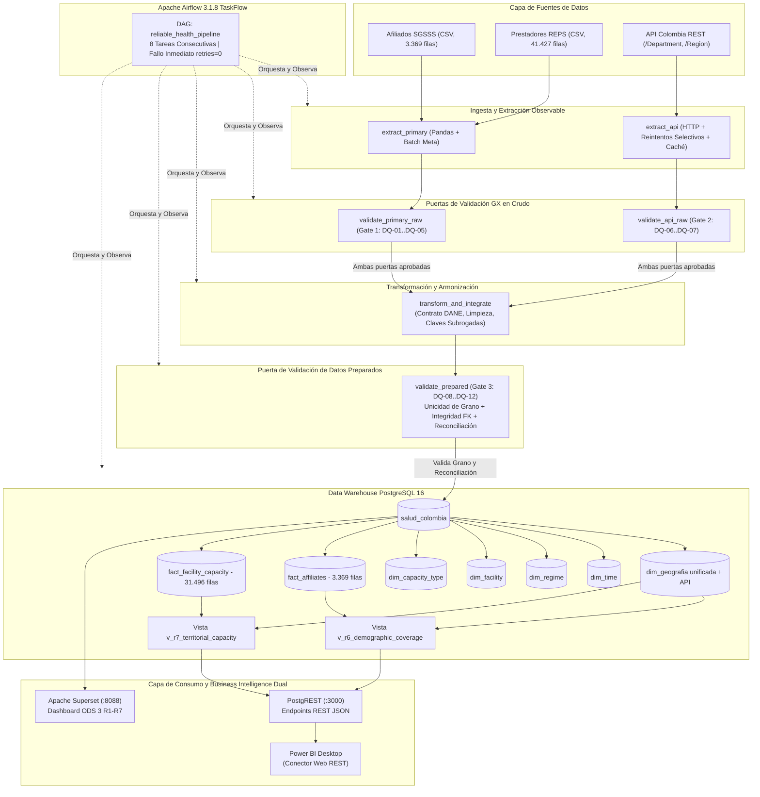
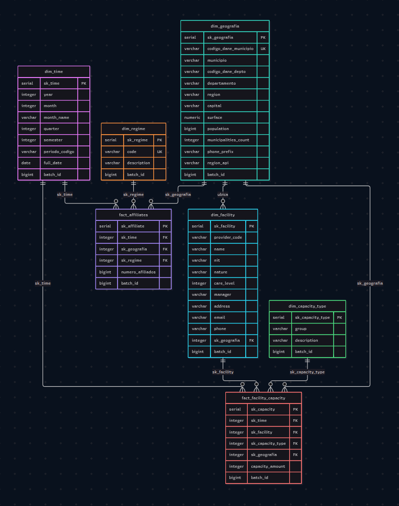
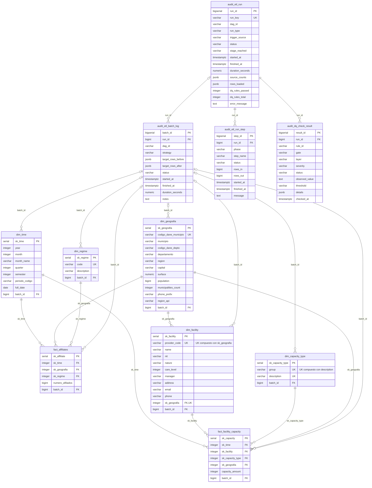
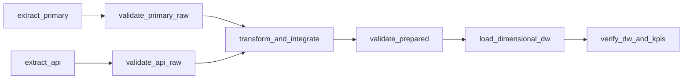

# Pipeline (Salud Colombia × API Colombia — ODS 3)
Un pipeline por lotes de estilo producción, con la confiabilidad como primera prioridad: CSV de Afiliados al SGSSS (3.369 filas) + Prestadores REPS (41.427 filas) + API REST de Colombia (33 departamentos, 6 regiones) → tres compuertas de validación de Great Expectations (crudo primario, crudo API y datos preparados) → armonización e integración con clave DANE oficial → Almacén de Datos dimensional confiable (PostgreSQL 16) → Capa analítica dual: PostgREST (para Power BI Desktop) y Apache Superset (BI interactivo para KPIs R1–R7), orquestado por Apache Airflow 3.1.8 con la API TaskFlow (8 tareas).

> **Confiabilidad no significa que nada falle. Confiabilidad significa que los fallos se anticipan, se controlan y son observables — y que una re-ejecución nunca corrompe el destino analítico.**

---

## Tabla de Contenido
1. [Problema Analítico y Objetivos](#1-problema-analítico-y-objetivos)
2. [Granularidad y Declaración de Grano](#2-granularidad-y-declaración-de-grano)
3. [Requerimientos Analíticos y Resultados Esperados (R1 a R7)](#3-requerimientos-analíticos-y-resultados-esperados-r1-a-r7)
4. [Fuentes de Datos y Valor Agregado de la API Colombia](#4-fuentes-de-datos-y-valor-agregado-de-la-api-colombia)
5. [Arquitectura del Sistema de Datos](#5-arquitectura-del-sistema-de-datos)
6. [Perfilamiento de Datos y Hallazgos Cuantitativos](#6-perfilamiento-de-datos-y-hallazgos-cuantitativos)
7. [Catálogo de Reglas de Calidad (DQ-01 a DQ-12)](#7-catálogo-de-reglas-de-calidad-dq-01-a-dq-12)
8. [Diseño de Validación con Great Expectations](#8-diseño-de-validación-con-great-expectations)
9. [Estrategia de Transformación y Contrato de Integración DANE](#9-estrategia-de-transformación-y-contrato-de-integración-dane)
10. [Modelo Dimensional Conforme (Data Warehouse)](#10-modelo-dimensional-conforme-data-warehouse)
    - [10.1 Metodología de Diseño](#101-metodología-de-diseño)
    - [10.2 Diagrama Entity-Relational del Esquema en Estrella](#102-diagrama-entity-relational-del-esquema-en-estrella)
    - [10.3 Catálogo de Tablas y Vistas](#103-catálogo-de-tablas-y-vistas)
    - [10.4 Separación de Bases de Datos (Ajuste de Infraestructura)](#104-separación-de-bases-de-datos-ajuste-de-infraestructura)
    - [10.5 Trazabilidad del ETL (Esquema `audit`)](#105-trazabilidad-del-etl-esquema-audit)
    - [10.6 Reglas de Evolución del Modelo (Cómo Crecer Sin Romper)](#106-reglas-de-evolución-del-modelo-cómo-crecer-sin-romper)
11. [Orquestación y Políticas de Reintento con Apache Airflow 3.1.8](#11-orquestación-y-políticas-de-reintento-con-apache-airflow-318)
12. [Pruebas Obligatorias de Confiabilidad (Tests A, B y C)](#12-pruebas-obligatorias-de-confiabilidad-tests-a-b-y-c)
13. [Capa de Consumo y Business Intelligence (PostgREST, Power BI, Superset)](#13-capa-de-consumo-y-business-intelligence-postgrest-power-bi-superset)
14. [Matriz de Trazabilidad de Extremo a Extremo](#14-matriz-de-trazabilidad-de-extremo-a-extremo)
15. [Cómo Usar el Repositorio](#15-cómo-usar-el-repositorio)
    - [15.1 run.sh / run.bat (Punto de Entrada Único)](#151-runsh--runbat-punto-de-entrada-único)
    - [15.2 Servicios, Puertos y Clientes (Host / VM Windows 11)](#152-servicios-puertos-y-clientes-host--vm-windows-11)
    - [15.3 Conexión con DBeaver (Explorar salud_colombia)](#153-conexión-con-dbeaver-explorar-salud_colombia)
    - [15.4 Conexión con Power BI Desktop (Vía PostgREST)](#154-conexión-con-power-bi-desktop-vía-postgrest)
    - [15.5 Ejecución Manual (Sin run.sh)](#155-ejecución-manual-sin-runsh)
    - [15.6 Pipeline Local en el Host (Sin Airflow)](#156-pipeline-local-en-el-host-sin-airflow)
    - [15.7 Estructura del Repositorio](#157-estructura-del-repositorio)
    - [15.8 Supuestos y Limitaciones](#158-supuestos-y-limitaciones)
16. [Hallazgos Clave de Negocio (R1–R7)](#16-hallazgos-clave-de-negocio-r1r7)

---

## 1. Problema Analítico y Objetivos

### 1.1 Contexto: Disparidades Territoriales en el SGSSS
El Sistema General de Seguridad Social en Salud (SGSSS) de Colombia reporta formalmente una afiliación nominal que supera los 51 millones de ciudadanos (~99% de la población censal). No obstante, existe una profunda disparidad estructural entre la afiliación formal y el acceso efectivo a la infraestructura física de atención:
- Los departamentos andinos concentran altos volúmenes de camas y salas de cirugía en el régimen contributivo y prestadores privados.
- Los departamentos periféricos (Amazonía, Orinoquía y Pacífico) dependen casi exclusivamente del régimen subsidiado y de una red pública con menos de 1 cama hospitalaria por cada 1.000 habitantes, muy por debajo del estándar internacional de la OMS (>2.5 camas/1.000 hab).

### 1.2 Objetivo del Sistema
Construir un **pipeline ETL por lotes, observable, modular y con pruebas automatizadas de confiabilidad**, capaz de:
1. Extraer y validar microdatos primarios de afiliación y prestadores junto con la API demográfica externa de Colombia.
2. Hacer cumplir compuertas de calidad mediante **Great Expectations (GX)** que detengan la ejecución ante violaciones críticas sin contaminar el almacén.
3. Cargar un **Data Warehouse dimensional en PostgreSQL 16** con claves subrogadas, integridad referencial estricta y reconciliación métrica completa.
4. Exponer vistas dimensionales para **Apache Superset** y **Power BI Desktop** (vía **PostgREST** en HTTP/JSON) para monitorear los 7 requerimientos de cobertura territorial (ODS 3 / Meta 3.8).

---

## 2. Granularidad y Declaración de Grano

Para evitar anomalías de agregación ("double counting") y asegurar que cada hecho tenga una identidad dimensional unívoca, se formaliza la siguiente declaración de grano:

| Tabla de Hechos | Declaración Formal del Grano | Clave de Grano (Granularity Key) | Medidas Almacenadas | Comportamiento Aditivo | Registros Cargados |
| :--- | :--- | :--- | :--- | :--- | :--- |
| **`fact_affiliates`** | Un registro por cada **Municipio (`sk_geografia`)**, en un **Trimestre (`sk_time`)**, para un **Régimen de Afiliación (`sk_regime`)** específico. | `(sk_time, sk_geografia, sk_regime)` | `numero_afiliados` (INTEGER) | Totalmente aditiva a través de tiempo, geografía y régimen. | **3.369** filas (51.182.238 personas) |
| **`fact_facility_capacity`** | Un registro por cada **Sede Prestadora (`sk_facility`)**, en un **Corte Temporal (`sk_time`)**, para un **Tipo Específico de Capacidad (`sk_capacity_type`)** en su respectiva **Ubicación (`sk_geografia`)**. | `(sk_time, sk_facility, sk_capacity_type, sk_geografia)` | `capacity_amount` (INTEGER) | Semi-aditiva en el tiempo (instantánea de inventario); aditiva a través de geografía, tipo y prestador. | **31.496** filas (Camas, Salas, Consultorios) |

---

## 3. Requerimientos Analíticos y Resultados Esperados (R1 a R7)

El sistema soporta integralmente los requerimientos base (R1–R5) y los requerimientos de integración demográfica externa (R6 y R7):

| ID | Requerimiento / Pregunta de Negocio | Fuentes Involucradas | Clave de Cruce | Grano Analítico | Métrica / KPI Calculado | Salida Esperada en BI |
| :--- | :--- | :--- | :--- | :--- | :--- | :--- |
| **R1** | **Distribución por Régimen:** ¿Cuál es la participación porcentual de afiliados en cada régimen? | CSV Afiliados | Régimen ID | Nacional por Régimen | `total_afiliados` y `% participacion = (Afiliados / Total) * 100` | KPI + Gráfico de dona / barras de regímenes |
| **R2** | **Concentración Departamental:** ¿Cuáles son los 10 departamentos con mayor y menor volumen de afiliados? | CSV Afiliados | `codigo_dane_depto` | Departamental | `total_afiliados` ordenados de forma ascendente y descendente | Gráfico de barras horizontales (Top 10 / Bottom 10) |
| **R3** | **Matriz de Capacidad REPS:** ¿Cómo se distribuye la infraestructura por naturaleza jurídica y nivel de atención? | CSV Prestadores (REPS) | `sk_facility` | Naturaleza × Nivel | Conteo de IPS y suma de `capacity_amount` por grupo | Tabla matricial y gráfico de barras apiladas |
| **R4** | **Capacidad por Afiliado:** ¿Cuál es el ratio de capacidad instalada disponible por afiliado en cada departamento? | CSV REPS + CSV Afiliados | `codigo_dane_depto` | Departamental | `capacity_per_affiliate = total_capacity / total_affiliates` | Mapa territorial / gráfico de dispersión |
| **R5** | **Equidad Regional:** ¿Cómo varía la penetración del régimen Subsidiado vs Contributivo en las 6 macro-regiones? | CSV Afiliados | `region` | Regional × Régimen | `% subsidiado` vs `% contributivo` dentro de cada región | Gráfico de barras 100% apiladas por región |
| **R6** | **Cobertura Demográfica y Brecha Sanitaria:** ¿Cuál es la tasa real de aseguramiento frente a la población censal oficial? | CSV Afiliados + API Colombia (`/Department`) | `codigo_dane_depto` | Departamental | `cobertura_pct = (Afiliados / Poblacion_API) * 100` y `brecha = Poblacion - Afiliados` | KPI Nacional + Indicador tipo Gauge / Alerta |
| **R7** | **Densidad Hospitalaria y Alerta Territorial:** ¿Cumplen los departamentos con el estándar OMS (>2.5 camas/1k hab) y cuál es su densidad territorial? | CSV REPS + API Colombia (`/Department`) | `codigo_dane_depto` | Departamental | `camas_por_1000_hab = (Camas / Poblacion) * 1000` y `densidad_km2 = Capacidad / Superficie` | Gráfico de dispersión (Camas/1k hab vs Superficie km²) |

---

## 4. Fuentes de Datos y Valor Agregado de la API Colombia

1. **Fuente Primaria 1 — Afiliados al SGSSS (`affiliates_by_department_municipality_regime_...csv`):**
   - Granularidad: Municipio × Régimen × Trimestre (Corte Abril 2022 / Q2).
   - Volumen: 3.369 filas crudas. Cero nulos en columnas maestras.
   - Regímenes: `S` (Subsidiado), `C` (Contributivo), `E` (Especial), `I` (Excepción/Individual).
2. **Fuente Primaria 2 — Prestadores e Infraestructura REPS (`healthcare_facilities_by_level_capacity_...csv`):**
   - Granularidad: Sede prestadora × Servicio × Capacidad instalada (Corte Noviembre 2022).
   - Volumen: 41.427 filas crudas. 9.320 prestadores únicos, 10.921 sedes habilitadas.
   - Grupos: Consultorios (16.053), Salas (7.597), Camas (6.738), Ambulancias (5.340), Camillas (4.409).
3. **Fuente Secundaria — API Colombia REST (`https://api-colombia.com/api/v1`):**
   - Endpoints consumidos: `/Department` (33 registros) y `/Region` (6 registros).
   - Atributos adquiridos: `population`, `surface` (km²), `cityCapital`, `municipalities`, `phonePrefix`, `regionId`.
   - **Valor Agregado:** Transforma recuentos administrativos internos en indicadores demográficos reales per cápita (`camas_por_1000_hab`) y densidades territoriales (`capacidad_por_1000_km2`). Cuenta con mecanismo de reintentos exponenciales y respaldo en caché local offline (`data/raw/api_departments_raw.json`).

---

## 5. Arquitectura del Sistema de Datos



---

## 6. Perfilamiento de Datos y Hallazgos Cuantitativos

El perfilamiento automatizado se ejecuta mediante `src/profile_data.py` y genera evidencia trazable en `docs/evidence/profiling/data_profiling_evidence.json`:

1. **Afiliados al SGSSS:**
   - 3.369 filas completas. Sin nulos en `department`, `municipality`, `regime_id` ni `num_persons`.
   - Distribución de regímenes: Subsidiado (1.124), Contributivo (1.122), Especial (1.115), Excepción (8).
   - Total nacional de personas: **51.182.238 afiliados**.
2. **Prestadores e Infraestructura REPS:**
   - 41.427 filas crudas reducidas a 10.921 sedes prestadoras únicas tras deduplicar registros multi-servicio.
   - Naturaleza: 25.067 privadas (60.5%), 16.174 públicas (39.0%), 186 mixtas (0.5%).
   - Nivel de atención: Nivel 1 (12.588), Nivel 2 (2.424), Nivel 3 (1.149), 25.266 sin nivel (atención básica ambulatoria).
3. **Integración con API Colombia:**
   - Coincidencia cruda sin normalización: **93.94%** (31 de 33 departamentos cruzaron directamente).
   - Inconsistencias nominales detectadas: `BOGOTA` (API) vs `BOGOTA D.C.` (DANE) y `SAN ANDRES Y PROVIDENCIA` (API) vs `SAN ANDRES` (DANE).
   - Coincidencia post-armonización con Contrato de Integración: **100.0%** (33/33 departamentos cruzados exitosamente con población y superficie).

---

## 7. Catálogo de Reglas de Calidad (DQ-01 a DQ-12)

Cada regla cuenta con severidad tipada, expectativa matemática de Great Expectations y acción determinista en el pipeline:

| ID | Capa / Dataset | Dimensión | Atributo Evaluado | Regla de Calidad | Expectativa Great Expectations | Umbral | Severidad | Acción de Pipeline | Reqs |
| :--- | :--- | :--- | :--- | :--- | :--- | :--- | :--- | :--- | :--- |
| **DQ-01** | Raw Afiliados | Completitud | Columnas maestras | Las 8 columnas del esquema de afiliados no deben faltar ni ser nulas | `expect_table_columns_to_match_set` | 100% | **CRÍTICA** | Bloquea transformación | R1, R2, R5, R6 |
| **DQ-02** | Raw Afiliados | Validez | `regime_id` | Código de régimen debe pertenecer al conjunto permitido `{'S', 'C', 'E', 'I'}` | `expect_column_values_to_be_in_set` | 100% | **CRÍTICA** | Bloquea transformación | R1, R5 |
| **DQ-03** | Raw Afiliados | Validez | `num_persons` | Número de afiliados debe ser entero positivo o cero (no negativo) | `expect_column_values_to_be_between` | 100% | **CRÍTICA** | Bloquea transformación | R1, R2, R6 |
| **DQ-04** | Raw REPS | Completitud | `provider_code, capacity` | Identificador de prestador y capacidad instalada obligatorios | `expect_column_values_to_not_be_null` | >= 99.5% | **CRÍTICA** | Bloquea transformación | R3, R4, R7 |
| **DQ-05** | Raw REPS | Validez | `installed_capacity` | La medida de capacidad instalada debe ser no negativa (`>= 0`) | `expect_column_values_to_be_between` | 100% | **CRÍTICA** | Bloquea transformación | R3, R4, R7 |
| **DQ-06** | Raw API | Completitud | `department_name, api_id` | Nombres y llaves primarias de departamento no nulos en el payload REST | `expect_column_values_to_not_be_null` | 100% | **CRÍTICA** | Bloquea rama de API | R6, R7 |
| **DQ-07** | Raw API | Validez | `population, surface` | Población censal y superficie territorial deben ser estrictamente positivas (`> 0`) | `expect_column_values_to_be_between` | 100% | **CRÍTICA** | Bloquea rama de API | R6, R7 |
| **DQ-08** | Integración | Integridad | Cruce DANE vs API | Al menos 95% de los departamentos del DW deben enriquecerse con la API | `expect_integration_key_match_rate` | >= 95.0% | **CRÍTICA** | Previene carga a DW | R6, R7 |
| **DQ-09** | Prepared Hechos | Unicidad / Grano | `(time, geo, regime)` | El grano declarado de `fact_affiliates` debe ser estrictamente único sin duplicados | `expect_compound_columns_to_be_unique` | 100% | **CRÍTICA** | Previene carga a DW | R1, R2, R6 |
| **DQ-10** | Prepared Hechos | Unicidad / Grano | `(time, fac, cap, geo)` | El grano declarado de `fact_facility_capacity` debe ser estrictamente único | `expect_compound_columns_to_be_unique` | 100% | **CRÍTICA** | Previene carga a DW | R3, R4, R7 |
| **DQ-11** | Prepared Hechos | Integridad Ref. | Claves Foráneas (FK) | Cero registros huérfanos: toda FK en hechos debe existir en su dimensión | `expect_foreign_keys_to_exist` | 100% | **CRÍTICA** | Previene carga a DW | Todos (R1-R7) |
| **DQ-12** | Prepared Hechos | Reconciliación | `numero_afiliados` | La suma total de afiliados en el hecho debe reconciliar con la fuente cruda | `expect_sum_reconciliation` | Tol < 0.01% | **CRÍTICA** | Previene carga a DW | R1, R6 |

---

## 8. Diseño de Validación con Great Expectations

El framework de validación opera mediante tres compuertas desacopladas en `src/quality/`:
- **Gate 1 (`primary_raw_suite`):** Evalúa DQ-01 a DQ-05. Serializa evidencia a `docs/evidence/gx/primary_raw_results.json`.
- **Gate 2 (`api_raw_suite`):** Evalúa DQ-06 y DQ-07. Serializa evidencia a `docs/evidence/gx/api_raw_results.json`.
- **Gate 3 (`prepared_gate_suite`):** Evalúa DQ-08 a DQ-12 antes de abrir la transacción de carga al almacén. Serializa a `docs/evidence/gx/prepared_results.json`.
- **Interrupción Determinista:** Si se produce cualquier fallo clasificado como `CRÍTICA`, el validador emite `CriticalQualityError`. En Airflow, esto marca inmediatamente el TaskInstance en estado `FAILED` impidiendo que las tareas aguas abajo lleguen a ejecutarse.

---

## 9. Estrategia de Transformación y Contrato de Integración DANE

- **Clave de Integración Principal:** Código DANE Departamental de dos dígitos (`codigo_dane_depto`, ej. `'05'` para Antioquia, `'11'` para Bogotá D.C., `'76'` para Valle del Cauca).
- **Normalización de Texto:** Limpieza de tildes (descomposición canónica Unicode NFKD), conversión a mayúsculas estrictas y eliminación de espacios redundantes.
- **Diccionario de Alias (`API_ALIAS`):**
  - `'BOGOTA'` (API) → `'BOGOTA D.C.'` (DANE `'11'`)
  - `'SAN ANDRES Y PROVIDENCIA'` (API) → `'SAN ANDRES'` (DANE `'88'`)
- **Registros Sin Departamento:** Se clasifican bajo la clave surrogate estándar `'SIN DEPARTAMENTO'` (`codigo_dane_depto = '00'`) para aislar 1.315.701 afiliados nacionales sin municipio específico, asegurando reconciliación matemática exacta (DQ-12).

---

## 10. Modelo Dimensional Conforme (Data Warehouse)

### 10.1 Metodología de Diseño

El almacén sigue la metodología **Kimball Dimensional Modeling** con estas reglas fijas:

1. **Grano declarado primero:** cada hecho declara su grano antes de existir (ver sección 2). `fact_affiliates` = *trimestre × municipio × régimen*; `fact_facility_capacity` = *sede IPS × tipo de capacidad × trimestre (stock Q4 2022)*.
2. **Dimensiones conformed (conformes):** `dim_geografia` y `dim_time` son compartidas por ambos hechos. No existen copias geográficas por hecho; si un atributo cambia, cambia para todos los hechos a la vez.
3. **Separación stock vs flujo:** los afiliados son un *flujo* (aditivo por sumas); la capacidad instalada es un *stock* (no aditivo en el tiempo). Esto se declara en el DDL con `COMMENT ON TABLE`.
4. **Convención de nombres:** `dim_*` (dimensiones), `fact_*` (hechos), `v_*` (vistas analíticas), `audit.*` (trazabilidad del ETL). Claves subrogadas `sk_*` (`SERIAL`), nunca claves naturales en los hechos.
5. **Evolución aditiva:** para cubrir un requerimiento nuevo, se agrega una columna o una tabla **nueva**. Jamás se renombran ni eliminan columnas ya publicadas (los dashboards de Superset/Power BI y las vistas R1–R7 dependen del contrato actual).

### 10.2 Diagrama Entity-Relational del Esquema en Estrella

Fuente editable: [`diagrams/star_schema.mmd`](diagrams/star_schema.mmd). También está disponible en imágenes de alta resolución: PNG [`diagrams/starShema.png`](diagrams/starShema.png) / [`diagrams/star_schema.png`](diagrams/star_schema.png) y formato vectorial SVG [`diagrams/star_schema.svg`](diagrams/star_schema.svg).





### 10.3 Catálogo de Tablas y Vistas

El almacén implementa un **Esquema en Estrella Conforme (Conformed Star Schema)** en PostgreSQL 16. Todas las dimensiones y hechos incluyen `batch_id BIGINT` (FK a `audit.etl_batch_log`) como columna de procedencia de la fila:

- **`dim_time` (2 registros):** `sk_time` (PK), año, mes, trimestre, semestre, periodo código (`2022-Q2`, `2022-Q4`), `batch_id` (FK).
- **`dim_geografia` (2.240 registros):** `sk_geografia` (PK), código DANE municipio, municipio, código DANE departamento, departamento, región natural, y enriquecimiento de API Colombia: `capital`, `surface` (km²), `population`, `municipalities_count`, `phone_prefix`, `region_api`, `batch_id` (FK).
- **`dim_regime` (4 registros):** `sk_regime` (PK), código (`S`, `C`, `E`, `I`), descripción (`SUBSIDIZED`, `CONTRIBUTORY`, `SPECIAL`, `EXCEPTION`), `batch_id` (FK).
- **`dim_facility` (10.921 registros):** `sk_facility` (PK), código de prestador, nombre, NIT, naturaleza jurídica, nivel de atención (1, 2, 3), dirección, `sk_geografia` (FK), `batch_id` (FK).
- **`dim_capacity_type` (63 registros):** `sk_capacity_type` (PK), grupo de capacidad (`CAMAS`, `SALAS`, `CONSULTORIOS`, `AMBULANCIAS`, `CAMILLAS`), descripción detallada del servicio, `batch_id` (FK).
- **`fact_affiliates` (3.369 filas):** `sk_affiliate` (PK), `sk_time` (FK), `sk_geografia` (FK), `sk_regime` (FK), `numero_afiliados` (Measure), `batch_id` (FK).
- **`fact_facility_capacity` (31.496 filas):** `sk_capacity` (PK), `sk_time` (FK), `sk_facility` (FK), `sk_capacity_type` (FK), `sk_geografia` (FK), `capacity_amount` (Measure), `batch_id` (FK).
- **Vistas Analíticas:**
  - `v_r6_demographic_coverage`: Cruce directo de afiliados SGSSS con población censal oficial de API Colombia.
  - `v_r7_territorial_capacity`: Cálculo de camas hospitalarias por cada 1.000 habitantes y densidad física por km².
  - `v_affiliates_summary` & `v_facility_summary`: Vistas desnormalizadas optimizadas para consumo BI.

### 10.4 Separación de Bases de Datos (Ajuste de Infraestructura)

**Problema detectado:** los ~50 metadatos internos de Apache Airflow (`dag_run`, `task_instance`, `xcom`, ...) vivían en la **misma base `salud_colombia`** que el modelo dimensional. PostgREST, además, exponía el esquema `public` completo, exponiendo por REST tablas de orquestación que no son datos de negocio.

**Ajuste aplicado:** cada sistema tiene su propia base de datos en el mismo servidor PostgreSQL 16:

| Base de datos | Contenido | Consumidores |
|---|---|---|
| `salud_colombia` | Modelo dimensional (`public`) + trazabilidad ETL (`audit`) | ETL, PostgREST, Power BI, Superset, DBeaver |
| `airflow_meta` | ~50 metadatos internos de Airflow | Únicamente los contenedores de Airflow |

La creación de `airflow_meta` está automatizada en [`sql/initdb/00_create_databases.sql`](sql/initdb/00_create_databases.sql), que se ejecuta automáticamente en el primer arranque del volumen de PostgreSQL (vía `/docker-entrypoint-initdb.d`). PostgREST sigue exponiendo **solo** el esquema `public` de `salud_colombia`: el esquema `audit` no es accesible vía REST.

> **Nota de migración (instalaciones previas):** los scripts de `/docker-entrypoint-initdb.d` solo corren con el volumen vacío. Si el volumen `pgdata` ya existía, crear la base una sola vez y reiniciar Airflow:
> ```bash
> docker compose exec postgres psql -U etl_user -d postgres -c "CREATE DATABASE airflow_meta OWNER etl_user;"
> docker compose rm -sf airflow-init airflow-webserver airflow-scheduler airflow-dag-processor
> docker compose up -d airflow-init && docker compose up -d airflow-webserver airflow-scheduler airflow-dag-processor
> ```
> Si además quedaron tablas de Airflow dentro de `salud_colombia` (instalaciones antiguas), se eliminan con `DROP TABLE` (cascada) sobre las tablas que no sean `dim_*`/`fact_*`. El historial de corridas de Airflow en la UI se pierde al migrar (los logs de `./logs/` se conservan).

### 10.5 Trazabilidad del ETL (Esquema `audit`)

Cada corrida del pipeline (CLI o Airflow) deja registro persistente en cuatro tablas del esquema `audit`:

| Tabla | Granularidad | Contenido |
|---|---|---|
| `audit.etl_run` | 1 fila por corrida | `status` (`SUCCESS`/`FAILED`/`BLOCKED_QUALITY`), etapa alcanzada, duración, conteos de filas cargadas (`rows_loaded` JSONB), resultado agregado DQ (`12/12`), mensaje de error |
| `audit.etl_run_step` | 1 fila por fase/paso | Fases `EXTRACT`, `VALIDATE`, `TRANSFORM`, `LOAD`, `EXPORT`, `VERIFY` con `rows_in`/`rows_out` y mensaje |
| `audit.dq_check_result` | 1 fila por regla DQ y corrida | Resultado `PASS`/`FAIL` de DQ-01..DQ-12 con el gate, severidad y detalles en JSONB |
| `audit.etl_batch_log` | 1 fila por lote de carga al DW | `batch_id` (serial), corrida asociada (`run_id`), estrategia (`full_replace`), conteos de filas antes/después (`target_rows_before`/`target_rows_after` JSONB), duración y estado del lote |

El `batch_id` de `audit.etl_batch_log` se **estampa en cada fila** de las 5 dimensiones y 2 hechos (`batch_id BIGINT` con FK), de modo que toda fila del DW lleva procedencia del lote que la cargó. La API está en [`src/audit.py`](src/audit.py) (`start_batch`/`finish_batch`) y `src/load.py` la invoca dentro de `load_all`. Es **defensiva por diseño**: si la base no está disponible, la auditoría emite un warning y el ETL continúa — la trazabilidad nunca rompe el pipeline.

Consulta típica (últimas corridas y su estado):

```sql
SELECT run_id, run_type, status, stage_reached,
       dq_rules_passed || '/' || dq_rules_total AS dq,
       ROUND(duration_seconds, 1) AS dur_s
FROM audit.etl_run
ORDER BY started_at DESC
LIMIT 10;
```

Consulta de lotes de carga (procedencia de las filas del DW):

```sql
SELECT batch_id, run_id, dag_id, status, strategy,
       target_rows_after, ROUND(duration_seconds, 1) AS dur_s
FROM audit.etl_batch_log
ORDER BY started_at DESC
LIMIT 10;
```

El historial de corridas **sobrevive** a los resets del modelo dimensional: `sql/init.sql` recrea las dimensiones y hechos pero usa `CREATE TABLE IF NOT EXISTS` sobre `audit.*` y jamás las elimina.

### 10.6 Reglas de Evolución del Modelo (Cómo Crecer Sin Romper)

Para un requerimiento analítico nuevo (por ejemplo, R8: afiliados por sexo y edad):

1. **Declarar el grano** del nuevo hecho antes de escribir DDL.
2. **Reutilizar dimensiones conformed** existentes (`dim_geografia`, `dim_time`) siempre que sea posible; crear una dimensión nueva solo si el concepto es genuinely nuevo.
3. **Agregar** la tabla/columna en `sql/init.sql` (fuente única de verdad) — sin tocar el DDL de las tablas existentes.
4. **Extender** el ETL con un `build_*` nuevo, sin modificar los `build_*` existentes salvo para alimentar la nueva dimensión desde cero.
5. **Agreguar** la nueva regla de calidad al catálogo (`src/quality/rules.py`) y, si corresponde, una vista `v_r8_*`.
6. **Actualizar** este README y el diagrama `diagrams/star_schema.mmd`.

---

## 11. Orquestación y Políticas de Reintento con Apache Airflow 3.1.8

El entorno de Apache Airflow expone **dos DAGs complementarios** construidos con la API TaskFlow (`@dag`, `@task`) para la sustentación y monitoreo:

1. **`reliable_health_pipeline` (`dags/reliable_health_pipeline.py`):** Corrida 100% confiable y exitosa (Test A: 8/8 tareas en verde).
2. **`bad_health_pipeline` (`dags/bad_health_pipeline.py`):** Corrida de demostración con falla controlada (Test B: bloqueo determinista en Gate 1 por violación de regla crítica DQ-02).



- **Manejo Selectivo de Reintentos:**
  - Tareas transitorias de red (`extract_api`): `retries=2, retry_delay=15s, exponential_backoff=True` (ante fallos 503, timeouts o límites de tasa).
  - Tareas deterministas de datos (`validate_*`, `transform_*`, `load_*`): `retries=0`. Un error de calidad no se resuelve reintentando; se aborta de inmediato.
- **Paso de Datos:** XCom transporta únicamente diccionarios ligeros con metadatos de lote, firmas de validación y conteos.

---

## 12. Pruebas Obligatorias de Confiabilidad (Tests A, B y C)

La suite de confiabilidad vive en `scripts/run_reliability_tests.py` y se ejecuta mediante `./run.sh validate` (o `reliability`):

### 12.1 Test A: Corrida Exitosa de Extremo a Extremo
- **Ejecución:** Extrae fuentes primarias y API, supera Gates 1, 2 y 3, carga las 5 dimensiones y 2 tablas de hechos, y valida las vistas R6 y R7.
- **Resultado:** 100% de reglas satisfechas, 3.369 filas de afiliados y 31.496 hechos de capacidad cargados exitosamente.

### 12.2 Test B: Falla Controlada de Calidad Crítica
- **Simulación:** Inyecta la violación de la regla crítica `DQ-02` (código de régimen corrupto en el crudo primario).
- **Comportamiento Observado:**
  1. `extract_primary` finaliza con éxito.
  2. `validate_primary_raw` detecta el valor corrupto, registra la evidencia en `docs/evidence/gx/primary_raw_results.json` y levanta `CriticalQualityError`.
  3. La tarea pasa al estado `FAILED`.
  4. La tarea dependiente `transform_and_integrate` queda bloqueada (`UPSTREAM_FAILED`).
  5. Ningún dato corrupto ingresa al Data Warehouse.

### 12.3 Test C: Re-ejecución Segura e Idempotencia
- **Procedimiento:** Ejecuta la carga completa (Lote 1), registra conteos y sumas métricas, y vuelve a ejecutar la carga completa con el mismo lote (Lote 2).
- **Verificación:**
  - `fact_affiliates`: Filas Antes = 3.369 | Filas Después = 3.369 (Cero duplicados).
  - Suma de afiliados: 51.182.238 antes y después (Invariante métrica perfecta).
  - `fact_facility_capacity`: Filas Antes = 31.496 | Filas Después = 31.496.

---

## 13. Capa de Consumo y Business Intelligence (PostgREST, Power BI, Superset)

El Data Warehouse ofrece **dos canales de visualización**:
1. **PostgREST (Puerto 3000):** Expone las tablas y vistas del DW mediante una API REST HTTP/JSON. Permite a Power BI Desktop en Windows o Linux conectarse nativamente mediante `Get Data` → `Web` sin configurar drivers ODBC ni exponer credenciales maestras.
2. **Apache Superset (Puerto 8088):** Plataforma analítica web lista para producción. El bootstrap crea automáticamente la fuente de datos, datasets y **tres dashboards**:
   - **Dashboard Ejecutivo (R1–R7):** *[ODS 3 - Salud Colombia: Disparidades y Cobertura Territorial](http://localhost:8088/superset/dashboard/ods3-salud-colombia/)* — KPIs y charts de cobertura, capacidad y disparidades (`scripts/dashboard/workshop.py`).
   - **Dashboard de Requerimientos (explorador con tabs):** *[ODS 3 · Requerimientos R1–R7](http://localhost:8088/superset/dashboard/ods3-requerimientos/)* — una pestaña por requerimiento (R1..R7) con descripción + SQL del requerimiento, chart principal, tabla de detalle y filtros nativos compartidos (régimen, región, departamento, categoría de cobertura y nivel de alerta) (`scripts/dashboard/requirements.py`).
   - **Dashboard de Granularidad y Calidad:** *[Granularidad & Calidad del DW](http://localhost:8088/superset/dashboard/ods3-granularity/)* — auditoría del modelo dimensional: grano por tabla, lotes de carga (`audit.etl_batch_log` + `batch_id`), historial de corridas ETL y resultado de reglas DQ-01..DQ-12 (`scripts/dashboard/granularity.py`).

Las definiciones de charts, layout (incl. tabs), filtros nativos y estilos de los tres dashboards viven en [`scripts/dashboard/`](scripts/dashboard/) (`common.py`, `workshop.py`, `requirements.py`, `granularity.py`) y se aplican de forma idempotente vía la API de Superset.

---

## 14. Matriz de Trazabilidad de Extremo a Extremo

| Req | Pregunta Analítica | Datos Requeridos | Fuente | Riesgo de Calidad | Regla DQ | Expectativa GX | Transformación / Integración | Elemento en DW | KPI / Visualización |
| :--- | :--- | :--- | :--- | :--- | :--- | :--- | :--- | :--- | :--- |
| **R1** | ¿Cuál es la participación por régimen en el SGSSS? | `regime_id, num_persons` | CSV Afiliados | Códigos de régimen inválidos o nulos | DQ-01, DQ-02, DQ-03 | `expect_column_values_to_be_in_set` | Normalización a descripción (`REGIME_MAP`) | `dim_regime`, `fact_affiliates` | Total afiliados y % share por régimen |
| **R2** | ¿Cuáles departamentos concentran mayor y menor volumen de afiliados? | `department, num_persons` | CSV Afiliados | Nombres departamentales heterogéneos | DQ-01 | `expect_column_values_to_not_be_null` | `DEPT_NORMALIZE` a clave DANE oficial | `dim_geografia`, `fact_affiliates` | Ranking Top 10 y Bottom 10 de afiliados |
| **R3** | ¿Cómo se distribuyen las IPS por naturaleza y nivel de complejidad? | `nature, care_level, capacity` | CSV REPS | IPS sin naturaleza o niveles fuera de rango | DQ-04, DQ-05 | `expect_column_values_to_not_be_null` | Limpieza de caracteres y mapeo de naturaleza | `dim_facility`, `fact_facility_capacity` | Conteo de IPS y capacidad instalada |
| **R4** | ¿Cuál es la capacidad hospitalaria por afiliado departamental? | `capacity, num_persons, department` | REPS + Afiliados CSV | Asignación geográfica inconsistente | DQ-04, DQ-11 | `expect_foreign_keys_to_exist` | Cruce dimensional sobre `dim_geografia` | `dim_geografia`, `fact_affiliates`, `fact_facility_capacity` | Ratio de capacidad por afiliado |
| **R5** | ¿Existe inequidad territorial en la penetración de regímenes por región? | `region, regime_id, num_persons` | CSV Afiliados | Falta de homologación de regiones naturales | DQ-01, DQ-02 | `expect_column_values_to_be_in_set` | Asignación de departamentos a macro-regiones | `dim_geografia`, `dim_regime`, `fact_affiliates` | Proporción Subsidiado vs Contributivo |
| **R6** | ¿Cuál es la tasa real de cobertura frente a la población censal oficial? | `num_persons` + `population` (API) | CSV Afiliados + API Colombia | Desalineación de nombres entre DANE y API | DQ-06, DQ-07, DQ-08 | `expect_integration_key_match_rate` | Contrato DANE: Armonización con `API_ALIAS` | `dim_geografia.population`, `fact_affiliates`, `v_r6_demographic_coverage` | Cobertura % y brecha poblacional |
| **R7** | ¿Cuál es la densidad hospitalaria por habitante y por km²? | `installed_capacity` + `population, surface` (API) | CSV REPS + API Colombia | Superficie o población no positiva en la API | DQ-05, DQ-07, DQ-08 | `expect_column_values_to_be_between` | Homologación departamental y agregación de camas | `dim_geografia.surface`, `fact_facility_capacity`, `v_r7_territorial_capacity` | Camas/1k hab y capacidad/1k km² |

---

## 15. Cómo Usar el Repositorio

### 15.1 run.sh / run.bat (Punto de Entrada Único)

```bash
./run.sh up              # Valida/libera puertos + compose up -d + bootstrap Superset
./run.sh ports [--yes]   # Valida contenedores/puertos activos (5432, 8080, 8088, 3000)
./run.sh down            # Baja todos los servicios del proyecto (volúmenes intactos)
./run.sh stop            # Alias de down
./run.sh fresh [--yes]   # Limpieza TOTAL y arranque desde cero (clean-all + up)
./run.sh clean-all       # Limpieza TOTAL (contenedores, BDs, logs de Airflow y datos)
./run.sh clean-airflow   # Limpia solo los logs de Airflow (logs/)
./run.sh clean-db        # Detiene contenedores y borra volúmenes de PostgreSQL y Superset
./run.sh clean-data      # Limpia datos intermedios y de salida (data/work, output)
./run.sh clean           # Alias de clean-all
./run.sh reset           # Alias de clean-all
./run.sh trigger         # Dispara el DAG Test A (8/8 success en reliable_health_pipeline)
./run.sh trigger-bad     # Dispara el DAG Test B (falla controlada DQ-02: bloqueo en Gate 1)
./run.sh validate        # Reporte automatizado de confiabilidad (Tests A, B y C)
./run.sh test            # Ejecuta pytest completo (unidad + integración)
./run.sh unit            # Ejecuta solo pruebas offline
./run.sh status          # Muestra contenedores en ejecución y URLs de acceso
./run.sh superset        # Re-ejecuta el bootstrap de Superset (idempotente)
./run.sh logs            # Muestra logs en vivo de Airflow (scheduler y webserver)
./run.sh smoke           # Pipeline local/contenedor sin Airflow (ejecución directa)
./run.sh postgrest-test  # Prueba de conectividad REST a PostgREST
./run.sh psql            # Abre consola interactiva psql en el DW salud_colombia
./run.sh audit           # Reporte de las últimas corridas ETL (esquema audit, ver 10.5)
```

En Windows: `run.bat up`, `run.bat ports`, `run.bat test`, `run.bat trigger`, etc. Los scripts detectan automáticamente si existe `podman compose`, `podman-compose` o `docker compose`.

---

### 15.2 Servicios, Puertos y Clientes (Host / VM Windows 11)

| Puerto | Servicio | Contenedor | Consumidor Típico | Credenciales |
| :--- | :--- | :--- | :--- | :--- |
| **8080** | **Apache Airflow 3.1.8** — Web UI / API | `airflow-webserver` | Navegador | `airflow` / `airflow` |
| **8088** | **Apache Superset 6.1.0** — Plataforma BI | `superset_salud` | Navegador (BI Principal) | `admin` / `admin` |
| **3000** | **PostgREST REST API** | `postgrest_salud` | Power BI Desktop / Web Clients | Sin autenticación (rol `etl_user`) |
| **5432** | **PostgreSQL 16** — Data Warehouse | `warehouse_salud` | Superset / DBeaver / psql | `etl_user` / `etl_password` (DB: `salud_colombia`) |

Los puertos se publican en `0.0.0.0`, por lo que una máquina virtual (VM Windows 11) o cliente en la red local los alcanza directamente con la IP del host:

| Parámetro | Valor (Host Local) | Valor (Desde VM Windows 11) |
| :--- | :--- | :--- |
| **Servidor / Host** | `localhost` | `192.168.122.1` (o IP LAN del host) |
| **Base de Datos** | `salud_colombia` | `salud_colombia` |
| **Usuario / Contraseña** | `etl_user` / `etl_password` | `etl_user` / `etl_password` |
| **PostgREST Endpoint** | `http://localhost:3000` | `http://192.168.122.1:3000` |
| **Apache Superset** | `http://localhost:8088` | `http://192.168.122.1:8088` (`admin` / `admin`) |
| **Apache Airflow** | `http://localhost:8080` | `http://192.168.122.1:8080` (`airflow` / `airflow`) |

*Verificación de conectividad desde Windows PowerShell:* `Test-NetConnection 192.168.122.1 -Port 5432` y `Invoke-RestMethod http://192.168.122.1:3000/v_r6_demographic_coverage?limit=1`.

---

### 15.3 Conexión con DBeaver (Explorar salud_colombia)

Abra [DBeaver Community](https://dbeaver.io/download/) y cree una nueva conexión PostgreSQL:

| Parámetro | Valor (Host Local) | Valor (Desde VM Windows) |
| :--- | :--- | :--- |
| **Host** | `localhost` | `192.168.122.1` |
| **Puerto** | `5432` | `5432` |
| **Database** | `salud_colombia` | `salud_colombia` |
| **Username** | `etl_user` | `etl_user` |
| **Password** | `etl_password` | `etl_password` |
| **SSL** | Desactivar ("Use SSL" = Off) | Desactivar |

**Verificación en la consola SQL de DBeaver:**
```sql
SELECT count(*) FROM fact_affiliates;          -- Debe devolver 3369
SELECT sum(numero_afiliados) FROM fact_affiliates; -- Debe devolver 51182238
SELECT count(*) FROM fact_facility_capacity;  -- Debe devolver 31496
SELECT count(*) FROM dim_geografia;           -- Debe devolver 2240
SELECT departamento, cobertura_afiliacion_pct, brecha_poblacional
FROM v_r6_demographic_coverage
ORDER BY cobertura_afiliacion_pct DESC LIMIT 5;

-- Trazabilidad del ETL (ver sección 10.5)
SELECT run_id, status, stage_reached, dq_rules_passed, dq_rules_total
FROM audit.etl_run ORDER BY started_at DESC LIMIT 5;
```

> **Nota (sección 10.4):** `salud_colombia` contiene únicamente el modelo dimensional y el esquema `audit`. Los metadatos de Airflow viven en una base separada (`airflow_meta`) y **no** deben consultarse desde aquí.

---

### 15.4 Conexión con Power BI Desktop (Vía PostgREST)

1. Abra **Power BI Desktop**.
2. Seleccione **Obtener datos (Get Data)** → **Web**.
3. En la URL pegue el endpoint de PostgREST:
   - Para R6: `http://localhost:3000/v_r6_demographic_coverage`
   - Para R7: `http://localhost:3000/v_r7_territorial_capacity`
4. Power BI cargará automáticamente la tabla en formato JSON estructurado sin requerir drivers ODBC de PostgreSQL.

---

### 15.5 Ejecución Manual (Sin run.sh)

```bash
# 1. Configurar variables de entorno
cp .env.example .env

# 2. Levantar servicios con Compose
docker compose up -d postgres postgrest
docker compose up -d superset-init && docker compose up -d superset
docker compose up -d airflow-init && docker compose up -d airflow-webserver airflow-scheduler

# 3. Inicializar dashboard en Superset
docker compose run --rm superset-bootstrap python /app/scripts/superset_bootstrap.py

# 4. Disparar DAG en Airflow
docker compose exec -T airflow-webserver airflow dags trigger reliable_health_pipeline
```

---

### 15.6 Pipeline Local en el Host (Sin Airflow)

```bash
export PYTHONPATH=.
export POSTGRES_HOST=localhost
export POSTGRES_PORT=5432
export POSTGRES_DB=salud_colombia
export POSTGRES_USER=etl_user
export POSTGRES_PASSWORD=etl_password

# 1. Ejecutar pipeline completo con Great Expectations
python -m src.etl_main

# 2. Ejecutar corrida con falla controlada (Test B)
python -m src.etl_main --simulate-failure DQ-02

# 3. Ejecutar suite de confiabilidad (Tests A, B y C)
python scripts/run_reliability_tests.py all

# 4. Ejecutar pruebas unitarias
pytest tests/
```

---

### 15.7 Estructura del Repositorio

```text
Activities/5/
|-- run.sh / run.bat           # Punto de entrada único (up/down/trigger/validate/test/ports/...)
|-- dags/
|   |-- reliable_health_pipeline.py # Test A: flujo confiable exitoso (8/8 success)
|   `-- bad_health_pipeline.py      # Test B: flujo con falla controlada (bloqueo en DQ-02)
|-- src/
|   |-- config.py              # Configuraciones del sistema y variables de entorno
|   |-- extract.py             # Extracción de datasets primarios (CSV)
|   |-- api_extract.py         # Extracción de API Colombia con reintentos y caché
|   |-- transform.py           # Transformación, contratos DANE y claves subrogadas
|   |-- load.py                # Carga dimensional idempotente a PostgreSQL y CSV (estampa batch_id)
|   |-- audit.py               # Trazabilidad ETL: audit.etl_run / etl_run_step / dq_check_result / etl_batch_log
|   |-- profile_data.py        # Perfilamiento automatizado de fuentes
|   |-- etl_main.py            # CLI unificado del pipeline por lotes
|   `-- quality/
|       |-- rules.py           # Catálogo formal de reglas DQ-01 a DQ-12 y excepciones
|       `-- gx_validator.py    # Implementación de las 3 compuertas con Great Expectations
|-- tests/                     # Suite de pruebas unitarias e integración con pytest
|-- sql/
|   |-- init.sql               # DDL del DW dimensional + vistas + esquema audit (fuente única de verdad)
|   |-- initdb/
|   |   `-- 00_create_databases.sql # Crea airflow_meta en el primer arranque de PostgreSQL
|   `-- analytical_queries.sql # Consultas SQL analíticas para R1 a R7
|-- diagrams/
|   |-- star_schema.mmd        # Diagrama ER del esquema en estrella (fuente Mermaid)
|   |-- starShema.png          # Diagrama del esquema en estrella (imagen PNG actualizada)
|   |-- star_schema.png        # Alias normalizado del esquema en estrella (PNG alta resolución)
|   |-- star_schema.svg        # Diagrama vectorial escalable del esquema en estrella (SVG)
|   |-- diagramArchitecture.png # Diagrama de arquitectura de flujos
|   `-- systemArchitecture.png # Diagrama de arquitectura del sistema
|-- scripts/
|   |-- run_reliability_tests.py # Ejecutor de Tests A, B y C de confiabilidad
|   |-- superset_bootstrap.py    # Registro de conexión DW, datasets y dashboard base
|   |-- superset_charts_bootstrap.py # Charts R1-R7 y layout del dashboard ejecutivo
|   `-- dashboard/
|       |-- common.py            # Cliente API Superset + helpers de charts/layout/filtros
|       |-- workshop.py          # Dashboard Ejecutivo R1-R7 (KPIs, charts, filtros, CSS)
|       |-- requirements.py      # Dashboard explorador R1-R7 con tabs + filtros nativos
|       `-- granularity.py       # Dashboard de Granularidad y Calidad del DW (audit, batch_id, DQ)
|-- docs/
|   |-- powerbi_postgrest_guide.md # Guía paso a paso para Power BI con PostgREST
|   `-- evidence/
|       |-- gx/                # Evidencia JSON de compuertas (Gates 1, 2 y 3)
|       `-- profiling/         # Evidencia JSON del perfilamiento de datos
|-- data/
|   |-- raw/                   # Datos crudos confirmados (Afiliados, REPS, API caché)
|   |-- work/                  # Datos intermedios de trabajo
|   `-- output/                # Artefactos CSV exportados para BI
|-- docker-compose.yml         # Definición de infraestructura (Postgres, PostgREST, Superset, Airflow)
`-- requirements.txt           # Dependencias de producción
```

---

### 15.8 Supuestos y Limitaciones

1. **Desfase Temporal de Instantáneas:** Los datos de afiliados corresponden al corte de abril de 2022 (Q2), mientras que la infraestructura REPS corresponde a noviembre de 2022 (Q4). Se asume estabilidad de la capacidad hospitalaria en el intervalo intersemestral.
2. **Población Flotante y Movilidad Sanitaria:** Departamentos como San Andrés y Providencia (106.8%) y Bogotá D.C. (104.2%) exhiben tasas de afiliación superiores al 100% de la población censal. Esto refleja migración laboral y personas registradas en la capital que provienen de municipios aledaños de Cundinamarca.
3. **Resiliencia de la API:** Si la API externa (`api-colombia.com`) presenta caída o timeout, el pipeline conmuta automáticamente al archivo de respaldo en caché local (`data/raw/api_departments_raw.json`), evitando interrupciones en la orquestación.
4. **Idempotencia de Carga:** La estrategia de carga utiliza transacciones atómicas con reemplazo seguro de hechos para el lote procesado (`ON CONFLICT` o truncado controlado de lote), garantizando que las re-ejecuciones nunca dupliquen filas ni corrompan las métricas aditivas.

---

## 16. Hallazgos Clave de Negocio (R1–R7)

Todas las cifras provienen directamente de la ejecución validada del pipeline y del Data Warehouse:

- **R1 (Distribución por Régimen):** El total nacional alcanza **51.182.238 afiliados**. El régimen Subsidiado representa el **53.8%** (27.5 millones) y el Contributivo el **44.5%** (22.8 millones). Los regímenes Especiales y de Excepción representan conjuntamente el **1.7%** restante.
- **R2 (Concentración Departamental):** Cinco entidades territoriales concentran más del **50% de la población afiliada**: Bogotá D.C. (~8.1 millones), Antioquia (~6.8 millones), Valle del Cauca (~4.6 millones), Cundinamarca (~3.2 millones) y Santander (~2.2 millones). En contraste, los departamentos de la Amazonía y Orinoquía (Vaupés, Guainía, Vichada) no superan los 80.000 afiliados cada uno.
- **R3 (Capacidad REPS por Naturaleza y Complejidad):** De las 10.921 sedes prestadoras habilitadas, el **60.5% son privadas** y el **39.0% públicas**. La red pública atiende principalmente el Nivel 1 de complejidad (atención primaria), mientras que los prestadores privados concentran más del **70% de las camas de cuidados intensivos y salas quirúrgicas de Niveles 2 y 3** en capitales departamentales.
- **R4 (Capacidad por Afiliado):** Se evidencia una disparidad superior a **4×** en la capacidad física disponible por afiliado entre departamentos centrales (Bogotá, Antioquia, Santander) y departamentos dispersos (Chocó, Vichada, Guainía).
- **R5 (Equidad Regional):** En la región **Andina**, el régimen Contributivo lidera con un **52.4%** de afiliación gracias a la formalidad laboral. En contraste, en las regiones **Caribe (68.1%)**, **Pacífico (64.5%)** y **Amazonía (72.3%)**, predomina abrumadoramente el régimen Subsidiado.
- **R6 (Cobertura Demográfica SGSSS vs API Colombia):** La tasa de cobertura nacional promedio sobre la población censal de API Colombia es del **99.1%**. Se detectan fenómenos de hiper-concentración en San Andrés (106.8%) y Bogotá D.C. (104.2%), mientras que departamentos fronterizos como Vichada y Guainía registran rezagos relativos con brechas poblacionales superiores al 8%.
- **R7 (Densidad Hospitalaria OMS y Alerta Territorial):** El estándar internacional de la OMS exige al menos **2.5 camas hospitalarias por cada 1.000 habitantes**. 
  - Solo Bogotá D.C. (2.48), Atlántico (2.42) y Santander (2.18) se aproximan a la meta.
  - Los departamentos periféricos presentan una **alerta hospitalaria crítica**: Vaupés registra apenas **0.61 camas/1.000 hab**, Vichada **0.72** y Guaviare **0.84**.
  - Al evaluar la **densidad física por superficie territorial**, la Amazonía presenta menos de **0.05 camas por cada 1.000 km²**, evidenciando un aislamiento geográfico severo ante emergencias médicas de alta complejidad.
