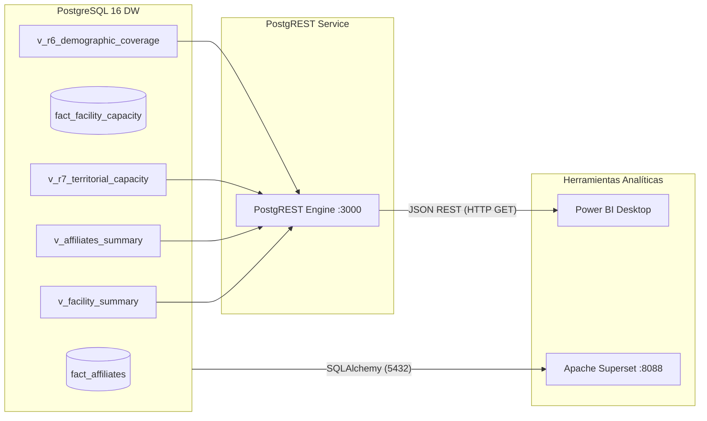

# Guía de Integración: Power BI con PostgREST y PostgreSQL Data Warehouse

Esta guía documenta la arquitectura y los pasos exactos para consumir los datos del Data Warehouse dimensional de Salud Colombia en **Power BI Desktop**, utilizando **PostgREST** como pasarela RESTful de alta velocidad sin requerir drivers ODBC/OLEDB locales ni dependencias de red complejas.

---

## 1. Arquitectura de Conectividad



---

## 2. Endpoints Disponibles en PostgREST

Una vez levantada la infraestructura (`./run.sh up` o `docker compose up -d`), PostgREST expone los siguientes endpoints HTTP en el puerto `3000`:

| Endpoint | Requerimiento Soportado | Descripción | Contrato de Datos |
| :--- | :--- | :--- | :--- |
| `http://localhost:3000/v_r6_demographic_coverage` | **R6 (Integrado)** | Cobertura de afiliación SGSSS vs Población oficial DANE/API Colombia | JSON Array de departamentos con tasas y brechas |
| `http://localhost:3000/v_r7_territorial_capacity` | **R7 (Integrado)** | Densidad hospitalaria (camas/1.000 hab y capacidad/km²) | JSON Array de departamentos con indicadores de infraestructura |
| `http://localhost:3000/v_affiliates_summary` | **R1, R2, R5** | Afiliados consolidados por régimen, departamento y región | JSON Array con granularidad geográfica-temporal |
| `http://localhost:3000/v_facility_summary` | **R3, R4** | Capacidad instalada por IPS, naturaleza y nivel de atención | JSON Array de sedes y capacidad |
| `http://localhost:3000/dim_geografia` | **Dimension Conforme** | Maestro geográfico unificado y enriquecido con API Colombia | DANE + Superficie + Población + Capital |
| `http://localhost:3000/` | **Documentación OpenAPI** | Especificación OpenAPI 3.0 interactiva para Swagger / Postman | OpenAPI Schema |

---

## 3. Pasos de Conexión en Power BI Desktop

### Método 1: Conector Web Estándar (Interfaz Gráfica)

1. Abra **Power BI Desktop**.
2. En la cinta de opciones superior, seleccione **Obtener datos** (`Get Data`) → **Web**.
3. En la ventana emergente, seleccione **Básico** e introduzca la URL del endpoint deseado. Por ejemplo:
   ```text
   http://localhost:3000/v_r6_demographic_coverage
   ```
4. En la pantalla de **Autenticación**, seleccione **Anónimo** (`Anonymous`) con nivel de privacidad *Organizational* o *Public*. (PostgREST está configurado con rol anónimo directo hacia el esquema `public` de PostgreSQL).
5. En el editor de **Power Query**:
   - Power BI cargará una lista de registros JSON (`List`).
   - En la pestaña de herramientas, haga clic en **A la tabla** (`To Table`).
   - Haga clic en el icono de **Expandir columnas** en el encabezado de la columna y desmarque la opción *"Usar el nombre de la columna original como prefijo"*.
   - Seleccione los tipos de datos apropiados (Texto para nombres/códigos, Número decimal para porcentajes, Número entero para afiliados/población).
6. Haga clic en **Cerrar y aplicar**.

---

### Método 2: Power Query M Script Directo (Recomendado)

Puede pegar directamente el siguiente código en el **Editor Avanzado** de Power Query para cargar y tipar las vistas en un solo paso:

#### Script M para R6 (Cobertura Demográfica):
```powerquery
let
    Source = Json.Document(Web.Contents("http://localhost:3000/v_r6_demographic_coverage")),
    #"Converted to Table" = Table.FromList(Source, Splitter.SplitByNothing(), null, null, ExtraValues.Error),
    #"Expanded Column1" = Table.ExpandRecordColumn(#"Converted to Table", "Column1", 
        {"codigo_dane_depto", "departamento", "region", "poblacion_oficial_api", "total_afiliados_sgsss", 
         "afiliados_subsidiado", "afiliados_contributivo", "cobertura_afiliacion_pct", "brecha_poblacional", "categoria_cobertura"}),
    #"Changed Type" = Table.TransformColumnTypes(#"Expanded Column1",{
        {"codigo_dane_depto", type text},
        {"departamento", type text},
        {"region", type text},
        {"poblacion_oficial_api", Int64.Type},
        {"total_afiliados_sgsss", Int64.Type},
        {"afiliados_subsidiado", Int64.Type},
        {"afiliados_contributivo", Int64.Type},
        {"cobertura_afiliacion_pct", type number},
        {"brecha_poblacional", Int64.Type},
        {"categoria_cobertura", type text}
    })
in
    #"Changed Type"
```

#### Script M para R7 (Densidad Hospitalaria):
```powerquery
let
    Source = Json.Document(Web.Contents("http://localhost:3000/v_r7_territorial_capacity")),
    #"Converted to Table" = Table.FromList(Source, Splitter.SplitByNothing(), null, null, ExtraValues.Error),
    #"Expanded Column1" = Table.ExpandRecordColumn(#"Converted to Table", "Column1", 
        {"codigo_dane_depto", "departamento", "region", "poblacion_oficial_api", "superficie_km2", 
         "total_ips_habilitadas", "total_camas", "total_salas", "capacidad_total_instalada", 
         "camas_por_1000_hab", "capacidad_por_1000_km2", "densidad_territorial_infraestructura", "nivel_alerta_hospitalaria"}),
    #"Changed Type" = Table.TransformColumnTypes(#"Expanded Column1",{
        {"codigo_dane_depto", type text},
        {"departamento", type text},
        {"region", type text},
        {"poblacion_oficial_api", Int64.Type},
        {"superficie_km2", type number},
        {"total_ips_habilitadas", Int64.Type},
        {"total_camas", Int64.Type},
        {"total_salas", Int64.Type},
        {"capacidad_total_instalada", Int64.Type},
        {"camas_por_1000_hab", type number},
        {"capacidad_por_1000_km2", type number},
        {"densidad_territorial_infraestructura", type number},
        {"nivel_alerta_hospitalaria", type text}
    })
in
    #"Changed Type"
```

---

## 4. Filtrado y Consultas Dinámicas mediante PostgREST

PostgREST permite aplicar filtros directamente en la URL para optimizar la carga en Power BI sin traer registros innecesarios:

- **Filtrar por Región (ej. Región Caribe):**
  ```text
  http://localhost:3000/v_r6_demographic_coverage?region=eq.Caribe
  ```
- **Departamentos con déficit de cobertura (< 90%):**
  ```text
  http://localhost:3000/v_r6_demographic_coverage?cobertura_afiliacion_pct=lt.90
  ```
- **Top 10 departamentos por camas hospitalarias:**
  ```text
  http://localhost:3000/v_r7_territorial_capacity?order=camas_por_1000_hab.desc&limit=10
  ```
